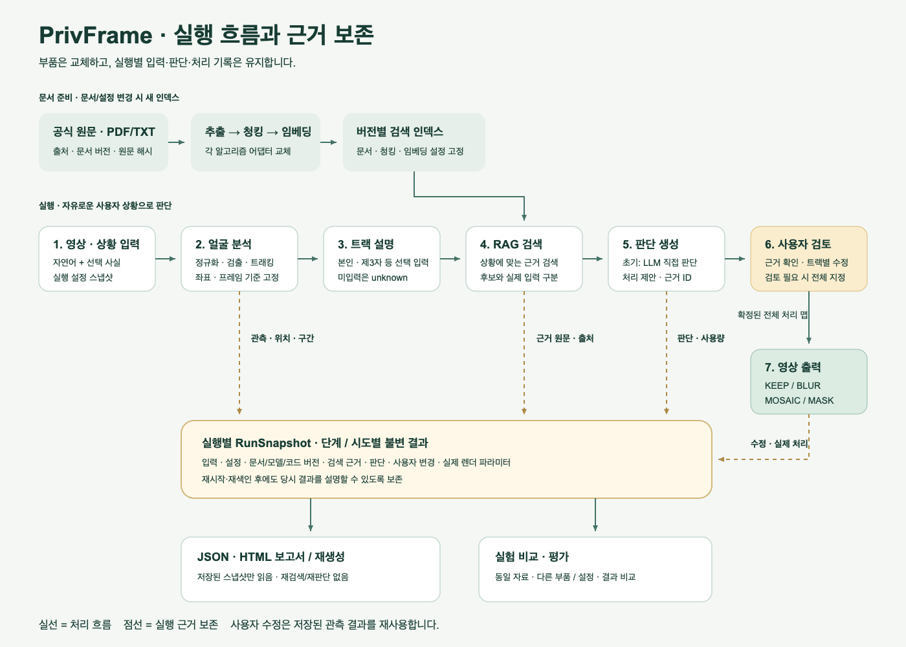

# 캡스톤 4-2 · PrivFrame

영상·상황 설명과 검색 근거로 얼굴 처리 제안을 만들고, 사용자가 검토한 결과를 영상과 보고서로 내보내는 연구용 베이스라인입니다. 알고리즘과 모델을 교체하며 비교할 수 있도록 모듈형 모놀리스와 Ports & Adapters로 구현했습니다.

- [팀 공유용 구현 계획](docs/PrivFrame_구현계획.md)
- [파이프라인 SVG](docs/pipeline.svg) · [PNG](docs/pipeline.png) · [편집용 Mermaid](docs/pipeline.mmd)
- [검증 결과와 제한](docs/검증결과.md)



## Mac에서 실행

Python 3.12는 uv가 관리합니다. Node 24와 npm이 필요합니다.

```bash
brew install uv ffmpeg redis
cp .env.example .env
# 실제 임베딩·판단을 사용할 때만 .env의 OPENAI_API_KEY를 설정합니다.
./scripts/dev.sh
```

웹: **http://localhost:5173** · API: **http://127.0.0.1:8000/docs**

스크립트는 의존성·모델 checksum을 확인하고 Redis, API, worker, Vite를 실행합니다. Ctrl-C로 이 스크립트가 시작한 프로세스를 종료합니다. 이미 떠 있는 Redis는 재사용합니다. 8000/5173 포트를 사용 중인 개발 서버가 있으면 중복 실행을 거부합니다. 로그는 `data/logs/`에 있습니다. 파일과 실행 결과는 기본 `data/`, 얼굴 모델은 `models/`에 저장합니다.

개별 프로세스를 실행하려면:

```bash
uv sync --frozen
uv run python scripts/download_model.py
redis-server --bind 127.0.0.1 --port 6379
uv run celery -A privframe.worker:celery_app worker --pool=solo --concurrency=1 --loglevel=INFO
uv run uvicorn privframe.api:app --host 127.0.0.1 --port 8000
# 다른 터미널
cd frontend
npm ci
npm run dev
```

## 첫 실행 흐름

1. **문서·색인:** 공식 자료 가져오기 또는 PDF/TXT 업로드. 추출이 READY가 되면 문서를 선택해 프로필별 인덱스를 생성합니다.
2. **새 실행:** 영상, 자유로운 상황, 선택 사실, 프로필과 인덱스를 선택합니다.
3. **트랙 설명:** 분석된 연속 등장 구간을 확인하고 필요한 트랙에 본인/제3자 등의 설명을 입력합니다.
4. **판단:** 판정 생성을 요청하면 트랙 설명까지 포함해 근거를 검색하고 처리 제안을 만듭니다. RAG 후보·실제 LLM 입력·인용을 확인하고, 트랙별 KEEP/BLUR/MOSAIC/MASK를 수정할 수 있습니다.
5. **출력:** 전체 트랙의 처리가 유효하면 렌더합니다. 검토 필요 상태는 전체 트랙을 직접 지정한 실험 출력을 허용합니다. 얼굴 0개는 별도 확인이 필요합니다.
6. **실험:** 다른 맥락·프로필로 새 실행을 만들면 이전 기록을 유지합니다. 검출 설정이 같으면 영상 분석을 재사용합니다. HTML/JSON 보고서는 저장된 실행 데이터로 재생성합니다.

출력 후 처리 방식·강도만 바꾸려면 **처리만 수정해 다시 출력**을 선택하세요. 이전 분석·검색 근거·판단을 복사한 새 실행에서 수정·렌더만 수행합니다. 검출·검색·LLM 호출 없이 이전 출력과 완료 기록을 유지합니다. CLI는 `revise RUN_ID`가 같은 동작을 제공합니다.

인덱스와 실행의 청킹·임베딩 설정은 일치해야 합니다. 검출기만 바꾸는 `haar`는 `baseline` 인덱스를 함께 사용할 수 있고, `small-chunks`는 해당 설정의 새 인덱스가 필요합니다.

API 키 없이 흐름을 확인하려면 문서 색인과 실행 모두 **fixture** 프로필을 명시적으로 선택하세요. 실제 Chroma·영상 검출·렌더를 사용하지만 임베딩과 판단은 테스트용입니다. fixture는 UI와 보고서에 표시되며 OpenAI 실패 시 자동으로 전환되지 않습니다.

## Linux에서 실행

```bash
cp .env.example .env
docker compose up --build
```

http://localhost:8000에서 빌드된 React UI와 API를 제공합니다. API·worker는 같은 Dockerfile/코드베이스로 빌드하며 Redis가 broker 역할을 합니다. 결과는 호스트 `./data`에 유지됩니다. 다른 호스트에서 접속할 때는 SSH 터널로 8000 포트를 연결할 수 있습니다. 초기 구성은 CPU 실행입니다.

`docker compose down`은 컨테이너를 종료하고 `data/`의 실행 기록을 유지합니다. Mac 네이티브 실행과 컨테이너 실행을 **동일 data 디렉터리에서 동시에** 실행하지 마세요. worker lock은 중복 프로세스를 거부합니다. API와 worker는 동일 호스트의 로컬 디스크를 공유해야 합니다.

## 구성과 교체 방법

| 프로필 | 용도 |
|---|---|
| `baseline` | YuNet + 1200/150 청킹 + OpenAI 임베딩/직접 판단 |
| `haar` | 검출기만 Haar로 변경 |
| `small-chunks` | 청킹만 800/100으로 변경 |
| `fixture` | 명시적인 오프라인 통합 테스트; 실제 법률 판단 아님 |
| `fixture-yunet` | 테스트용 임베딩·판단 + 실제 YuNet 검출; API 키 없이 영상 흐름 검증 |

`configs/*.yaml`의 변경은 새 실행에만 적용됩니다. `PipelineConfig`가 지원되는 선택과 범위를 검증합니다. 지원하지 않는 설정은 조용히 무시하지 않습니다. 새 알고리즘은 domain port를 구현하고 adapters factory와 config 선택에 추가한 뒤 bootstrap에서 연결합니다.

코드 책임은 다음처럼 나뉩니다.

- `backend/src/privframe/domain`: 공통 데이터, port, 누락·근거 연결·렌더 조건 검증.
- `application`: 프레임워크 객체를 전달받지 않는 명령과 단계별 파이프라인.
- `adapters`: LangChain/Chroma/OpenAI, OpenCV/FFmpeg, 스냅샷 보고서.
- `infrastructure`: SQLAlchemy 저장소, 아티팩트 저장. `bootstrap.py`가 구체 구현을 조립합니다.
- `api.py`와 `worker.py`: HTTP와 Celery 진입점. CLI·평가는 HTTP API를 사용하며 Chroma를 직접 열지 않습니다.

raw 영상과 썸네일은 외부 LLM에 전송하지 않습니다. 외부 API에는 문서 텍스트의 임베딩과 상황·트랙 설명·근거 텍스트가 전달됩니다. 키는 서버 환경에만 두고 실행 기록·프런트엔드에 포함하지 않습니다.

## 실행 기록과 재현성

문서 원문·페이지/조문·단위 내 문자 offset·청크 hash, 인덱스 설정, 모델 ID·checksum, 코드 fingerprint·패키지 버전·lock hash를 기록합니다. 조회된 후보와 실제 전달된 원문, 판단의 raw 응답·입력 prompt·usage, 사용자 수정과 실제 렌더 파라미터를 구분해 저장합니다.

각 단계의 시도별 snapshot과 산출물 경로는 다릅니다. 재전달된 완료 작업은 다시 실행하지 않습니다. 실패·중단 작업을 재시도하면 기존 시도는 유지하고 새 시도를 추가합니다. 진행 중인 시도를 재시도하면 이전 시도를 SUPERSEDED로 표시해 늦게 도착한 결과가 현재 결과를 덮어쓰지 않도록 합니다.

LLM 재호출의 완전한 결정성을 약속하지 않습니다. **당시 실제 입력과 출력의 보존**, 버전이 고정된 로컬 알고리즘, 같은 자료를 사용한 비교가 재현성 기준입니다. 완료된 실행의 입력은 수정할 수 없으며 새 실행으로 분기합니다. 보고서 재생성은 API 호출이나 재검색을 하지 않습니다.

## CLI와 평가

```bash
uv run privframe health
uv run privframe seed
uv run privframe list documents
uv run privframe upload-document ./my-law.txt
uv run privframe index DOCUMENT_ID --profile fixture
uv run privframe upload-video ./clip.mp4
uv run privframe run --video-id VIDEO_ID --index-id INDEX_ID --context '공개할 영상의 제3자 얼굴을 검토' --profile fixture
uv run privframe wait runs RUN_ID
uv run privframe decide RUN_ID
uv run privframe wait runs RUN_ID
uv run privframe render RUN_ID
uv run privframe wait runs RUN_ID
```

검토 필요 상태에서는 `override RUN_ID --file override.json`으로 전체 트랙을 지정합니다. JSON 형태는 `{"treatments":{"track-000001":{"action":"BLUR","strength":2}},"no_faces_confirmed":false}`이며 실제 분석된 트랙 ID를 사용하세요. 얼굴 0개는 `{"treatments":{},"no_faces_confirmed":true}`입니다.

fixture 평가 자료와 실행 명령은 [evaluation/README.md](evaluation/README.md)에 있습니다. 평가 자료는 합성 자료이며 법적 정확도 점수로 해석하지 않습니다. 원문 span을 기준으로 검색 coverage를 계산해 청크 크기를 바꿔도 비교할 수 있습니다. 트랙 수·계약 유효성·검토 사유·시간·사용량을 함께 기록합니다.

## 검사와 API 타입 생성

```bash
uv run ruff check backend scripts
uv run pytest -q
uv run privframe export-openapi --output frontend/openapi.json
cd frontend
npm run generate:api
npm run typecheck
npm run build
npx playwright install chromium
npm run test:e2e
```

Python 의존성은 `uv.lock`, 프런트엔드는 `package-lock.json`에 고정되어 있습니다. 외부 OpenAI 통신은 MockTransport 요청 직렬화 검증과 구분해서 보고합니다. 공개 seed는 지정 manifest의 세 출처만 가져오며 전체 법령 크롤링과 자동 갱신을 수행하지 않습니다.

초기 얼굴 분석은 연속 구간의 IoU 트래킹입니다. 재등장 인물의 동일성은 판별하지 않고, 검출되지 않은 프레임의 얼굴 영역을 임의로 보간하지 않습니다. 누락 구간은 normalization 기록에 남습니다. 번호판·OCR·신원 재식별·CUDA·규칙 기반 법적 판단은 후속 확장 대상입니다.
