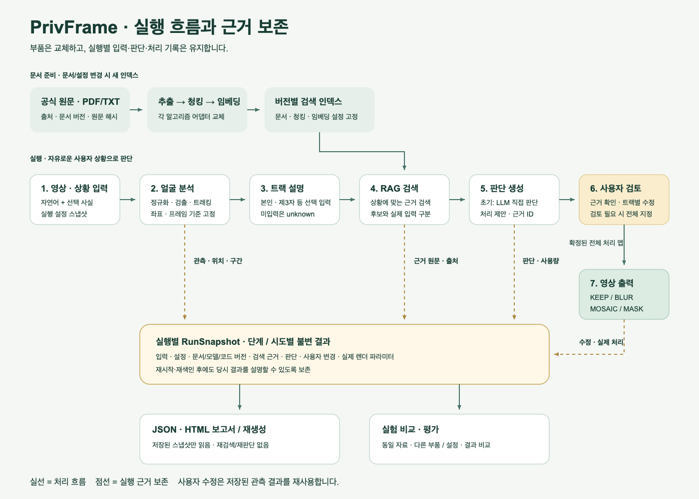
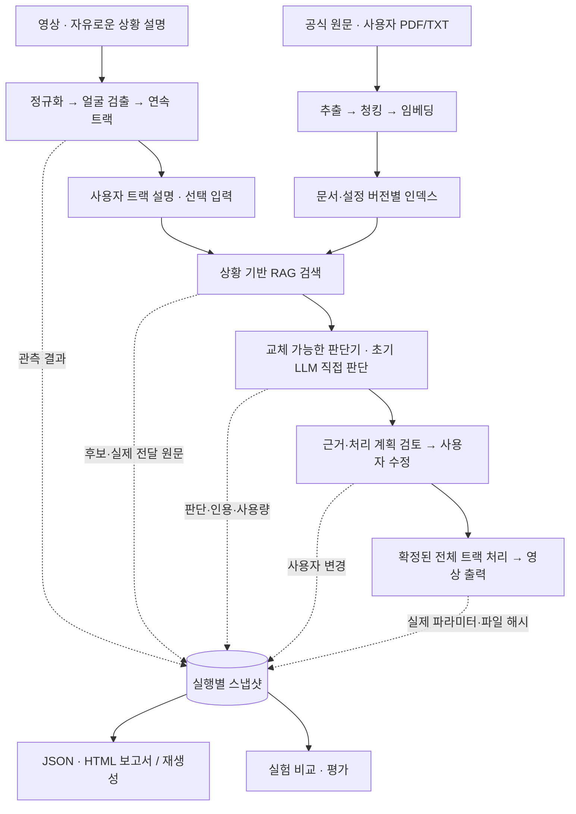

# PrivFrame 아키텍처와 베이스라인 구현 계획

팀 공유용 합의 계획 · 2026-10-02

> 이 문서는 최초 베이스라인 계획을 보존한 기록입니다. 2026-10-11에 추가한 장면 경계·ArcFace 인물 그룹화·인물별 동의 검토의 현재 동작은 [Identity Grouping 구현 안내](Identity_Grouping.md)를 참고하세요.

## 1. 채택할 아키텍처

**모듈형 모놀리스 + 교체 지점의 Ports & Adapters + 단계별 파이프라인**을 채택한다.

지금 안정적으로 정할 수 있는 것은 **각 모듈의 책임, 의존성 방향, 주고받는 데이터**다. 추출·청킹·임베딩·검색·판단·검출 알고리즘을 변경해도 이 경계를 유지하도록 만든다. 아키텍처 자체도 향후 규모와 요구가 달라지면 검토하지만, 현재의 실험 목적에는 이 구조가 적합하다. [Ports & Adapters 원문](https://alistair.cockburn.us/hexagonal-architecture)

백엔드는 하나의 Python 코드베이스로 구성하고, API와 작업 실행기는 별도 프로세스로 실행한다. 내부는 다음 책임으로 나눈다.

| 모듈 | 책임 |
|---|---|
| 문서·RAG | 원문 수집, 추출, 청킹, 색인, 검색과 근거 반환 |
| 영상 분석 | 얼굴 검출, 연속 트랙 생성, 위치·시간 정보 반환 |
| 판단 | 사용자 상황·영상 관측·검색 근거로 처리 계획 생성 |
| 영상 처리 | 확정된 처리 계획을 실제 픽셀에 적용 |
| 실행 기록 | 단계별 결과·설정·오류·사용자 변경 저장 |
| 보고서·평가 | 저장된 실행 결과를 읽어 보고서와 비교 결과 생성 |

핵심 로직은 FastAPI·Celery·LangChain·OpenCV의 객체에 직접 의존하지 않는다. 어댑터가 외부 라이브러리 결과를 공통 데이터로 변환한다. 초기부터 마이크로서비스로 분리하거나 범용 플러그인 시스템을 만들지는 않는다.

## 2. 초기 기술 구성과 교체 경계

아래 모델과 알고리즘은 **첫 실행을 위한 기본값**이다. 최종 연구 선택으로 고정하지 않는다.

| 영역 | 초기 선택 |
|---|---|
| 개발 환경 | Python 3.12 + uv, React + TypeScript + Vite |
| API·데이터 계약 | FastAPI + Pydantic, OpenAPI에서 프런트엔드 타입 생성 |
| 장시간 작업 | Celery + Redis, 초기 worker는 solo·동시 작업 1개 |
| 실행 데이터 | SQLAlchemy + SQLite WAL |
| 파일 저장 | 로컬 디스크의 관리된 데이터 디렉터리 |
| 문서 추출 | PDF는 pdfplumber, TXT는 텍스트 로더, 공식 법령 HTML은 별도 로더 |
| 청킹 | LangChain RecursiveCharacterTextSplitter, 1,200자·중복 150자 |
| 임베딩·검색 | OpenAI text-embedding-3-small + 영속 Chroma, 검색 상위 8개 |
| 판단 | OpenAI gpt-5.4-mini-2026-03-17, 구조화 출력으로 LLM 직접 판단 |
| 얼굴 검출·트래킹 | OpenCV 4.x + YuNet 2023mar ONNX, 인접 프레임 IoU 트래킹 |
| 영상 출력 | OpenCV의 영역 처리 + FFmpeg 인코딩·오디오 결합 |
| 보고서 | JSON 원본 기록 + HTML 보고서와 인쇄 화면 |

GPT-5.4 mini의 해당 스냅샷과 구조화 출력 지원을 공식 문서에서 확인했다. 모델 ID와 호출 설정은 실행별로 저장한다. [모델 문서](https://developers.openai.com/api/docs/models/gpt-5.4-mini)

**LangChain은 실제로 사용한다.** 청킹·임베딩·벡터 검색·모델 호출·구조화 출력을 재사용한다. 시스템 전체의 데이터와 실행 기록은 우리 계약으로 관리한다. [LangChain 구조화 출력](https://docs.langchain.com/oss/python/integrations/chat/openai)

Celery는 영상 처리와 색인처럼 오래 걸리는 작업을 담당한다. Airflow의 정기 배치 기능이나 LangGraph의 복잡한 분기·반복 기능은 초기 흐름에서 필요하지 않아 도입을 보류한다. [Celery 문서](https://docs.celeryq.dev/en/stable/getting-started/introduction.html)

교체 인터페이스는 추출기·청킹기·임베더·검색기·선택적 리랭커·판단기·검출기·트래커·렌더러에 둔다. 판단기는 공통 처리 계획을 반환하므로 나중에 규칙 엔진이나 혼합 방식을 추가할 수 있다.

Chroma는 **worker 한 프로세스가 전담**한다. API와 CLI는 작업을 요청하고 저장된 결과를 조회한다. 임베딩 모델이나 청킹을 바꾸면 새 인덱스를 만든다. [Chroma 프로세스·색인 제약](https://cookbook.chromadb.dev/core/system_constraints/)

## 3. 사용자 흐름과 데이터 보존

**문서 준비 → 영상·상황 입력 → 얼굴 분석 → 선택적 트랙 설명 → RAG 검색·LLM 판단 → 결과 검토·수정 → 영상 출력·보고서**

- 상황은 자유로운 자연어로 입력한다. 촬영 주체·촬영 방식·공개 대상·동의 여부는 선택적으로 보충한다. 지원 상황을 CCTV·SNS 같은 고정 목록으로 제한하지 않는다.
- 검출 결과에서 얼굴 썸네일과 등장 구간을 보여준다. 사용자는 트랙에 ‘본인’, ‘제3자’ 등의 설명을 붙일 수 있고, 미입력은 unknown으로 전달한다.
- 초기 트랙은 연속 등장 구간을 묶는다. 장면이 바뀌거나 재등장한 사람을 같은 신원으로 연결하는 기능은 후속 교체 대상으로 둔다.
- LLM은 상황·트랙 정보·검색 근거로 트랙별 KEEP / BLUR / MOSAIC / MASK와 지원 강도, 이유, 근거 ID, 추가로 필요한 정보를 반환한다.
- 사용자가 일부 트랙을 수정하면 저장된 분석 결과를 이용해 다시 렌더한다. 검출·검색·LLM 호출을 반복하지 않는다.

공통 데이터 계약은 다음 다섯 가지를 중심으로 구성한다.

| 계약 | 주요 내용 |
|---|---|
| ScenarioInput | 자연어 상황, 선택 사실, 사용자 트랙 설명 |
| VideoObservation | 작업 영상 정보, 트랙 ID, 프레임·시간·좌표, 검출 설정 |
| EvidenceBundle | 근거 ID, 원문, 문서·페이지·조문 위치, 출처, 문서·색인 버전 |
| DecisionPlan | 트랙별 처리 제안, 근거 ID, 설명, 검토 필요 여부 |
| RunSnapshot | 입력·설정·단계 결과·사용자 수정·실제 처리·산출물·오류 |

**검색 후보, 실제 LLM에 전달한 근거, LLM이 인용한 근거를 구분하여 저장한다.** 근거는 ID뿐 아니라 당시 원문과 출처도 보존한다.

보고서는 RunSnapshot에서 생성한다. 보고서 생성 과정에서 검색하거나 다시 판단하지 않는다. 문서 재색인, 모델 변경, 서버 재시작 후에도 당시 근거와 처리 결과로 재생성할 수 있어야 한다.

처리 계획의 형식·대상·근거 연결을 검사한다. 빠진 트랙을 자동으로 KEEP 처리하지 않는다. 정보나 근거가 부족하면 검토 필요 상태로 표시하고, 사용자가 모든 검출 트랙의 처리를 명시적으로 지정하면 실험 출력을 허용한다. 보고서에는 원래 판단과 검토 사유도 유지한다.

얼굴 0개는 별도로 표시한다. 원본 그대로 출력하려면 사용자의 명시적인 출력 선택을 기록한다.

API는 문서·인덱스·영상 업로드, 실행 생성·상태 조회, 트랙 설명, 판단 요청, 사용자 수정, 렌더 요청, 보고서·파일 다운로드를 제공한다. 장시간 요청은 작업 ID를 즉시 반환하고 UI는 진행 상태를 조회한다.

## 4. 구현 순서와 산출물

### ① 프로젝트 기반과 실행 기록

백엔드·프런트엔드·설정 디렉터리를 만들고 의존성을 잠근다. 공통 계약, 저장소, 작업 실행기, 단계 상태와 오류 기록을 먼저 구현한다. 영상 처리나 외부 API 호출 중에는 DB 트랜잭션을 유지하지 않는다.

### ② 문서와 RAG

초기 공식 자료는 다음 세 문서로 구성한다. 원문 접근과 한글 텍스트 추출 가능성을 확인했다.

- [개인정보 보호법](https://www.law.go.kr/LSW/lsInfoP.do?lsiSeq=283839&chrClsCd=010202&urlMode=lsInfoP&efYd=20260911&ancYnChk=0)
- [고정형 영상정보처리기기 설치·운영 안내서](https://www.privacy.go.kr/front/bbs/bbsView.do?bbsNo=BBSMSTR_000000000049&bbscttNo=20779)
- [이동형 영상정보처리기기를 위한 개인영상정보 보호·활용 안내서](https://www.privacy.go.kr/front/bbs/bbsView.do?bbsNo=BBSMSTR_000000000049&bbscttNo=20759)

공식 자료와 사용자 PDF/TXT를 같은 추출·색인 흐름으로 처리한다. 법률 시행일과 안내서 발간일을 구분하고, 원문 해시·수집일·출처를 저장한다. 텍스트가 추출되지 않는 PDF는 실패 이유를 표시한다. OCR과 자동 법령 갱신은 이후 어댑터로 추가한다.

### ③ 영상 분석과 처리

FFmpeg로 회전과 프레임 기준을 정규화한 공통 작업 영상을 만든다. 분석과 렌더는 같은 영상·좌표·프레임 기준을 사용한다. 얼굴 위치와 트랙을 저장하고, 처리 영역에 여유를 두어 블러·모자이크·마스크를 적용한다. 강도별 실제 파라미터와 버전도 기록한다.

### ④ 판단·웹 UI·보고서 연결

문서 관리, 영상·상황 입력, 트랙 검토, 판단·근거 확인, 사용자 수정, 결과 다운로드 화면을 구현한다. 보고서에는 사용한 근거, 판단 설명, 사용자 변경, 실제 처리 설정, 모델·색인 버전, 처리 시간·API 사용량·파일 해시를 담는다.

맥락이나 트랙 설명을 바꾸고 다시 판단하면 새 실행으로 기록한다. 호환되는 영상 분석 결과는 재사용하고, 완료된 이전 실행은 덮어쓰지 않는다.

### ⑤ 교체 실험과 실행 환경

YuNet 대신 Haar 검출기를 선택하는 프로필과 청킹 크기만 바꾸는 프로필을 추가해 실제 교체를 검증한다. UI와 평가 CLI는 같은 백엔드 실행 흐름을 사용한다.

Mac은 네이티브 개발 실행, Linux는 Docker Compose 실행을 제공한다. 두 환경 모두 CPU로 시작하며, NVIDIA GPU는 이후 영상 어댑터 교체 시 활용한다.

## 5. 검증 기준과 전제

완료 기준은 단순히 화면이 뜨는 것이 아니라 **업로드부터 영상·보고서 출력까지 연결되고, 부품을 바꿔 비교할 수 있는 상태**다.

- 검출기·청킹 설정을 바꿔도 판단·렌더·보고서 계약이 유지된다.
- 재시작·재색인 후 기존 보고서를 당시 근거로 재생성한다.
- 사용자 수정 시 재검출·재검색·재판단 없이 수정된 처리가 출력된다.
- 누락·중복 트랙, 존재하지 않는 근거 ID, 빈 검색, API 실패를 정상 완료로 처리하지 않는다.
- 회전·가변 FPS 영상에서도 위치와 시간이 맞고 오디오가 유지된다.
- 렌더 실패·재시도·작업 재전달이 이전 기록과 산출물을 덮어쓰지 않는다.
- 고정 평가 자료로 검색 근거 적합성, 검출 누락, 판단 결과, 시간·사용량을 비교한다.

pytest로 계약·파이프라인·렌더 검증을 수행하고, 프런트엔드 타입 검사·빌드 및 주요 사용자 흐름을 확인한다. 외부 API 없는 테스트는 명시적인 fixture 모드로 실행한다.

초기는 단일 사용자·한 호스트에서 실행하며 데이터는 삭제 전까지 보존한다. 번호판·OCR·신원 재식별·규칙 엔진·CUDA 처리는 후속 확장 대상이다. HTML 보고서는 인쇄로 PDF 저장할 수 있게 제공한다.

실제 OpenAI API 통합 검증은 API 키 설정 후 수행하며, 그전에는 미검증 상태를 명시한다. 이 문서는 합의된 계획이며, 실제 실행 방법과 검증 결과는 루트 README와 docs/검증결과.md에 기록한다.

## 파이프라인 도식

SVG로 바로 보기: [pipeline.svg](pipeline.svg). PNG 이미지: [pipeline.png](pipeline.png). 편집 가능한 원본: [pipeline.mmd](pipeline.mmd).

도식의 점선은 데이터 보존 경로다. 보고서는 당시 스냅샷만 읽으므로 재검색·재판단 없이 생성된다. 사용자 수정은 관측 결과를 재사용하며 렌더 단계에 적용된다.

## 구현 품질 원칙

- **재현성:** uv.lock·package-lock.json, 모델 checksum, 문서·청크 hash, 실행별 설정·코드·라이브러리 버전과 시도별 결과를 보존한다. LLM 재호출의 완전한 결정성을 보장하는 대신 실제 응답과 당시 입력을 저장한다.
- **재사용성:** API·UI·CLI가 같은 use case를 사용하고, 어댑터는 공통 계약을 구현한다. 호환되는 분석 결과는 후속 실험에서 재사용한다.
- **응집도:** 추출·검색·판단·관측·렌더·보고서의 책임을 분리한다. 검색기가 법률 판단을 하거나 보고서 생성기가 다시 검색하지 않는다.
- **결합도:** domain/application은 외부 프레임워크 객체를 전달받지 않는다. 라이브러리와 저장소의 구체 구현은 bootstrap에서 연결한다.
- **검증:** 교체 실험, 실제 FFmpeg 출력, 오류·누락·재시도, 스냅샷 재생성에 필요한 테스트를 우선한다. 실제 API 검증과 fixture 테스트를 구분한다.
