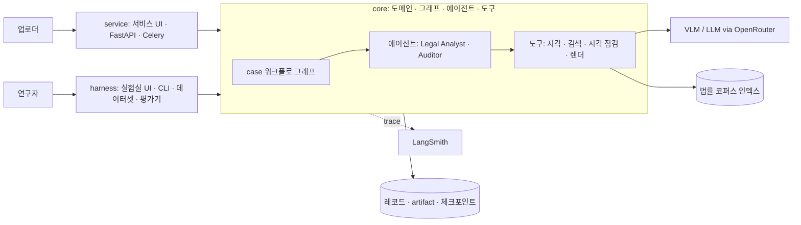
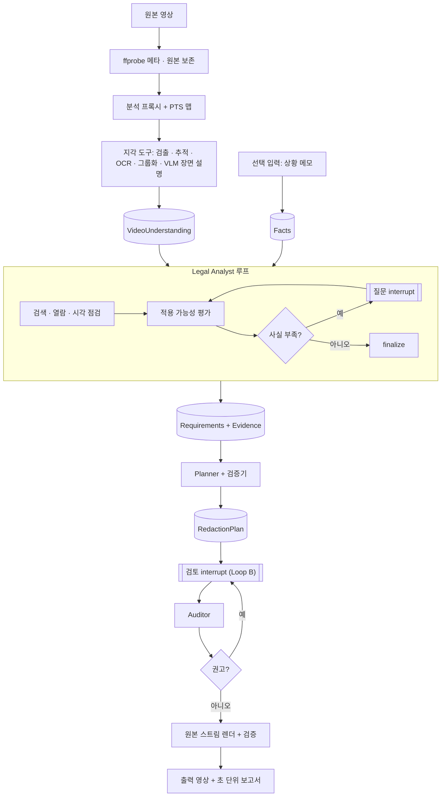
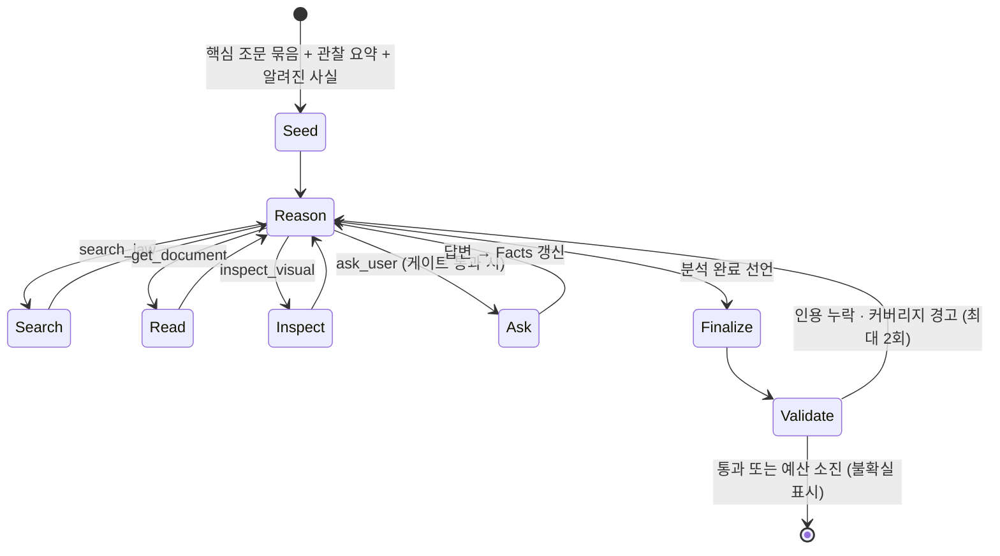
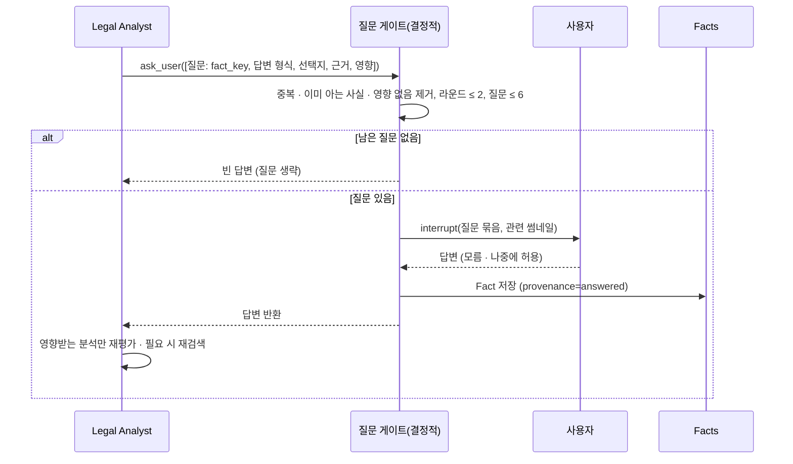
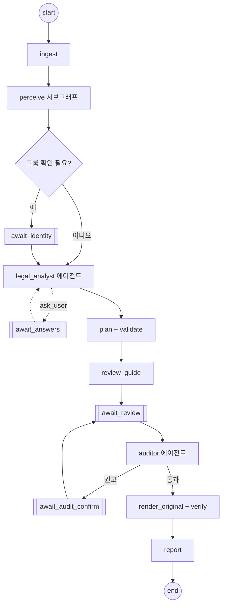

> PrivFrame 2.0 설계·PRD v2(승인본 2026-11-05)의 일부. 전체 목차와 다이어그램 검증 기록은 [README.md](./README.md).

## 4. 새 시스템 아키텍처

### 4.1 3층 구조 (다이어그램 D1)

- `core`는 `service`·`harness`를 import하지 않는다. 모델·프롬프트·도구 구현은 프로필과 `Runtime[Context]`로 주입한다.
- 에이전트는 LangChain 1.x `create_agent`(도구 호출 루프 + 미들웨어)로 만들고, 상위 `case` 그래프(StateGraph)가 서브그래프로 호출한다. 사용자 질문은 에이전트의 `ask_user` 도구가 `interrupt()`를 일으켜 구현한다(HITL 미들웨어 패턴).
- 결정적 도구(지각·검색·검증·렌더)는 에이전트와 분리된 순수 함수/어댑터이며 단독 평가 가능하다.

### 4.2 데이터 흐름 (D2)

흐름의 핵심: 법률 분석의 산출물은 "쟁점 목록"이 아니라 **근거가 붙은 보호 요건(Requirement)** 이다. Planner는 요건을 결정으로 바꾸고, Auditor는 요건 충족과 잔여 위험을 검증한다. "근거가 결정을 바꾼다"는 요건 ← 근거 ← 검색의 연쇄로 추적되고 반사실 코퍼스 실험으로 측정된다.

## 5. 동적 에이전트 워크플로

### 5.1 에이전트와 도구의 경계 (왜 2개만 에이전트인가)

| 단계 | 유형 | 이유 |
|---|---|---|
| 프록시 생성·검출·추적·OCR·그룹화 | 결정적 도구 | 입력이 같으면 출력이 같아야 캐시·재현·평가가 성립 |
| VLM 장면 설명·인물 속성 | 도구(모델 호출, 구조화 출력) | 호출 대상이 고정, 선택 판단 불필요 |
| **Legal Analyst** | **에이전트** | 무엇을 검색할지, 어느 조문을 읽을지, 어디를 다시 볼지, 무엇을 물을지, 언제 끝낼지가 상태에 따라 달라짐 |
| Planner | LLM 구조화 생성 + 결정적 검증 루프 | 요건 → 결정 변환은 거의 기계적, 충돌·유용성 조정만 LLM |
| Review Guide | LLM 단계(+검색 도구 1종) | 설명 생성; 자율 판단 불필요 |
| **Auditor** | **에이전트**(독립 모델군) | 사용자 수정 뒤 무엇을 재검증할지(요건 재검색·영역 재점검)를 스스로 선택 |
| 렌더·타임라인 조립·검증 지표 | 결정적 도구 | 정확성·재현성 |
| Report Writer | 결정적 조립 + LLM 서술 | 표·인용은 데이터에서, 서술만 LLM |

### 5.2 Legal Analyst 루프 (D3)

**상태(에이전트가 보는 정보)**: 관찰 요약(장면·대상·텍스트·속성, 프레임 참조), Facts(출처·신뢰도 포함), 지금까지의 분석 목록, 검색 이력, 남은 예산.

**도구**

| 도구 | 입력 → 출력 | 비고 |
|---|---|---|
| `search_law(query, kinds?, as_of?, k)` | 하이브리드 검색 + 리랭크 → 근거 후보(인용 표기·권위 등급·시행일) | 같은 질의 반복은 차단(dedupe) |
| `get_document(citation \| doc_id, span?)` | 조문·판례 섹션 본문 | 인용 검증의 기준 |
| `inspect_visual(question, target_ref \| time_range)` | VLM/OCR/연령 모델로 특정 영역·구간 재점검 → 구조화 답 | 예: "person-3 가슴의 텍스트가 명찰인가", "02:10 장면의 장소 유형" |
| `ask_user(questions[])` | 질문 게이트 → interrupt → 답변 | §5.3 |
| `checklist()` | 참고 패턴 목록(§5.5)과 관찰 기반 힌트 | 선택적 참고, 구속 없음 |
| `finalize(analysis)` | 구조화 결과 제출 → 검증기 | 종료 |

**finalize 출력 계약(요지)**: `analyses[]` = {question_of_law(자유 서술), provisions_considered[{citation, doc_id}], applicability: applies\|not_applies\|uncertain, conditions, reasoning_ko, evidence_ids, affected_targets, time_ranges, depends_on_facts[], confidence, pattern_ref?} ; `requirements[]` = {id, statement_ko(예: "공개 범위가 불특정 다수이므로 제3자 얼굴을 식별 불가 수준으로 처리"), targets, scope: face\|body\|text\|plate\|region, time_ranges, derived_from_analysis_ids, evidence_ids} ; `unresolved[]`(불확실·미답 사실과 보수적 가정).

**검증기(결정적)**: 모든 analysis는 `evidence_ids`가 검색 결과에 실제 존재하고 인용 표기가 문서와 일치해야 한다; 요건은 ≥1 analysis에서 파생되어야 한다; 시행일이 사건 시점에 유효한 문서만 인용 가능; `uncertain`은 보수적 가정을 명시해야 한다. 실패 사유를 에이전트에 되먹여 최대 2회 재시도, 이후 미해결로 기록. (인용 표기 대조는 ADR-0010으로 필요 없어졌고, 시행일 검사는 아직 없다)

**커버리지 점검(안전장치, 규칙 엔진 아님)**: 관찰(아동 추정·민감 장소·번호판·텍스트 등)과 참고 패턴을 대조해 "고려되지 않은 듯한 패턴"을 **질문 형태로 1회** 되돌린다("아동 포함 가능성을 검토했는가?"). 결정을 강제하지 않으며, 발생률을 지표로 추적해 에이전트 품질을 진단한다.

**시드(Seed)**: 비용·루프를 줄이기 위해 항상 관련 있는 핵심 문서 묶음(제2조 정의, 제15·17조, 제25조·제25조의2, 제58조·제58조의2, 표준지침 영상 조항, 가명 가이드라인 영상 절)을 결정적으로 먼저 제공한다. 이는 지식 사전 로딩이지 판단 규칙이 아니다; 에이전트는 그 밖의 검색을 자유롭게 수행한다. 트레이드오프: 시드가 편향을 줄 수 있어 반사실 실험(b)에서 시드도 함께 제거한다.

### 5.3 동적 질문 (D5)

- **질문의 생성 근거**: 에이전트가 적용 가능성 평가 중 `uncertain`의 원인이 "사실 부족"일 때만. 질문 객체는 `fact_key`(정규화된 키, 예: `purpose.publication_scope`, `person-2.is_uploader`, `recording.notice_displayed`), 답변 형식(단일/복수 선택·예/아니오·자유 서술·인물 선택·구간 선택), 에이전트가 생성한 선택지, `why`(어느 조문·판례의 어떤 요건 때문인지), `impact`(선택지별로 결정이 어떻게 달라지는지)를 가진다. **impact가 비어 있거나 모든 선택지의 영향이 같으면 게이트가 제거**한다(불필요 질문 최소화).
- **반영 구조**: Fact는 `{key, value, provenance: declared\|answered\|inferred, confidence, asked_by_analysis_ids}`. 분석은 `depends_on_facts`로 의존을 기록하므로, 답변·수정 시 **의존하는 분석만 무효화·재평가**된다(Loop B에서 사실을 바꿔도 동일).
- **질문 없이 진행**: 알려진 사실(상황 메모에서 추출된 `declared`, 관찰에서 고신뢰로 `inferred`)로 충분하면 질문 없이 finalize. 라운드 상한 도달 시 보수적 가정으로 진행하고, 미답 질문은 **검토 화면(Loop B)에 "나중에 답하기"로 이월**되어 답하면 재평가된다.
- **상황 메모(선택 입력)**: 업로드 시 자유 서술을 허용하되 LLM이 Fact로 추출(`declared`)하고 원문은 검색 질의로 쓰지 않는다. 비교: (a) 입력 없음 → 질문 라운드 증가, (b) 선택 메모 → 질문 감소, 추출 오류 위험(확인 UI로 완화), (c) 고정 폼 → 불필요 질문·확장성 저하. **(b) 채택**.
- 기존 11/6 선택지 코드는 에이전트가 선택지를 만들 때 **참고 어휘**로만 제공한다(강제 아님).

### 5.4 종료 조건·안전장치 (전체)

| 대상 | 예산·종료 | 위반 시 |
|---|---|---|
| Legal Analyst | 도구 호출 ≤ 25, 검색 ≤ 12, 질문 라운드 ≤ 2(라운드당 ≤ 6), 검증 재시도 ≤ 2, 동일 질의 반복 차단 | 강제 finalize(불확실 표시) |
| Planner | 생성 ≤ 3회(검증 피드백) | 미충족 요건을 `unsatisfied`로 기록, 검토 화면에 표시 |
| Auditor | 도구 호출 ≤ 10, 재검토 라운드 ≤ 1 | 미해결 위험으로 보고서 기록 |
| 케이스 전체 | 비용 상한(USD, LangSmith usage 집계), 벽시계 상한 | 상태 `PAUSED`(사유 `budget`)로 멈추고 상한을 올려 계속 |
| 근거 없는 판단 | 인용 검증기, 권위 등급·시행일 필터, "근거 없음 → uncertain" 규칙 | 되먹임·기록 |
| 출력 전 사람 승인 | Loop B 필수, Auditor 권고 거부 시 "위험 수용" 기록 | — |

### 5.5 택소노미의 역할 (참고 지식·체크리스트·평가 라벨)

v1의 I01~I17과 §11.3의 법적 프레임은 `configs/knowledge/issue_patterns.yaml`에 **참고 패턴**(패턴명, 전형적 근거, 관찰 트리거 힌트)으로 두고 ① `checklist()` 도구의 힌트, ② 커버리지 점검, ③ 평가 데이터셋 라벨, ④ Auditor의 점검 항목으로만 쓴다. 에이전트의 analysis는 `pattern_ref`가 없어도(신규 쟁점) 유효하며, 신규 쟁점 발생률을 지표로 추적해 패턴 목록을 갱신한다.

### 5.6 Planner · Review Guide · Auditor

- **Planner**: 입력 = requirements + targets(기하·시간) + facts(유용성 관련: 목적). 출력 = `RedactionPlan{decisions[{target_ref, scope: face\|body\|region\|text, method: keep\|blur\|mosaic\|mask, shape: ellipse\|box\|outline, time_ranges, satisfies: [requirement_id], rationale_ko, evidence_ids, alternatives[]}], unsatisfied[], summary}`. 검증기: 모든 요건이 ≥1 결정으로 충족되거나 `unsatisfied` 사유가 있어야 함; 모든 비-KEEP 결정은 요건에 연결; KEEP은 근거(본인·공적 인물·증거 필요성 등)와 analysis 연결; 기하·구간 유효. **베이스라인 Planner 4종**(static·rule_based·llm_only·naive_rag)은 같은 계약을 내는 전략 구현이다. 결정에는 **강도 필드가 없다**: 방식마다 식별 불가 수준이 고정되어 렌더러가 대상 크기에 맞춰 적용한다(ADR-0007, 가정 U10).
- **Review Guide(Loop B)**: 결정별 basis(요건·인용), similar_cases(코퍼스의 **실제** 판례·결정례·분쟁조정 사례를 `search_law`로 검색), risk_if_changed, alternatives, priority(위험 점수 순 정렬). 미답 질문 이월 표시. 사용자는 결정 수정·사실 수정·질문 답변을 할 수 있고, 사실 수정은 §5.3의 재평가를 트리거한다.
- **Auditor**: 입력 = 수정된 계획, 요건, 관찰. 도구 = `search_law`, `get_document`, `inspect_visual`. 출력 = `findings[{type: requirement_unmet\|residual_identifier\|over_redaction\|inconsistency, severity, target, time, evidence_ids, recommendation}]`. Planner·Analyst와 **다른 모델군**. 권고가 있으면 interrupt로 확인받고, 거부 시 위험 수용으로 기록.

### 5.7 case 그래프 (D4)

- 서브그래프 `perceive`는 결정적 노드 체인(ingest_probe → make_proxy → detect_track → group_identities → ocr → describe_segments → describe_persons → assemble)이며 노드별 입력 fingerprint 캐시(artifact)로 재실험 비용을 낮춘다.
- `legal_analyst`·`auditor`는 `create_agent` 서브그래프. interrupt는 `ask_user`/`await_*` 노드 첫 줄에서 호출하고, 그 앞 부수효과는 upsert로만.
- 체크포인터: SQLite(개발) → Postgres(서비스). `durability="sync"`(하네스·interrupt 구간). 모델·프롬프트 선택은 `context_schema`로 주입(상태 오염 방지). 시간 여행(`update_state` → 재실행)으로 "같은 근거·다른 모델" 실험.
- 상태 머신(서비스 투영): QUEUED → ANALYZING → [AWAITING_IDENTITY] → ANALYZING_LEGAL ↔ AWAITING_ANSWERS → PLANNING → AWAITING_REVIEW → AUDITING → [AWAITING_AUDIT_CONFIRM] → RENDERING → COMPLETED, 어느 단계든 FAILED/PAUSED(비용 상한에 닿으면 사유 `budget`으로 PAUSED).

