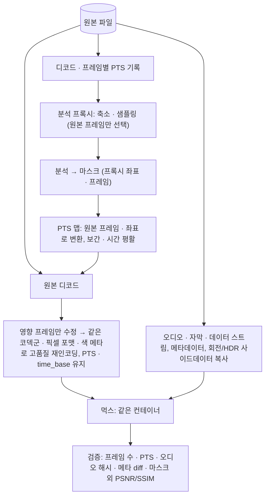

> PrivFrame 2.0 설계·PRD v2(승인본 2026-11-05)의 일부. 전체 목차와 다이어그램 검증 기록은 [README.md](./README.md).

## 6. 영상 처리와 원본 품질 보존 (G8)

### 6.1 현재 코드의 사실 (재확인)
정규화: `-vf fps=30,pad=…` + `-fps_mode cfr` + `libx264 veryfast crf 18 yuv420p` + `aac 128k`. 렌더: 정규화본 프레임을 rawvideo 파이프로 `libx264 veryfast crf 18` CFR 인코딩 → 정규화본 오디오 copy. 결과: 입력 VFR/원 fps·픽셀 포맷(10-bit/HDR)·회전 메타·원본 오디오·컨테이너 태그 모두 손실, 화질 2회 손실.

### 6.2 설계 (D6)

- **프록시는 분석 전용이며 프레임 수·PTS가 원본과 동일하다**: 축소만 하고(짧은 변 640~720, 비용에 따라 360까지) 타임스탬프는 그대로 통과시켜(`ffmpeg -i in.mp4 -map 0:v:0 -vf "scale=-2:<h>" -fps_mode passthrough -enc_time_base demux -c:v libx264 -preset veryfast -crf 20 -an proxy.mp4`) 프록시 프레임 i ↔ 원본 프레임 i가 **조회표**가 되게 한다(보간·재타이밍 없음). 분석 레이트(10~15 fps)는 프록시 인덱스의 서브샘플링이므로, 빠른 구간만 촘촘히 보는 적응형 샘플링을 프록시 재생성 없이 할 수 있다. 생성 직후 `nb_read_frames`와 PTS 목록이 원본과 같은지 단언하고, 다르면 PyAV로 원본을 1회 디코드해 인덱스별 `frame.pts/time_base` 표를 만든다(폴백). 좌표는 축소 배율로 원본 픽셀로 환산한다. 프록시는 자동 회전된(업라이트) 프레임으로 만들고 회전각을 기록한다 — libav/PyAV 디코드는 센서 방향 그대로이므로 렌더 시 마스크를 역회전으로 매핑한다.
- **OpenCV를 시간축의 기준으로 쓰지 않는다**: OpenCV FFmpeg 백엔드의 `CAP_PROP_FPS`는 `avg_frame_rate` 평균값이고 `CAP_PROP_POS_FRAMES` 탐색은 `frame/fps`로 초를 계산해 seek하므로 **CFR을 가정**해 VFR 파일에서 엉뚱한 프레임에 도달한다. 프레임 접근은 순차 디코드 + 인덱스, 임의 접근은 PyAV로 한다(현재 `adapters/track_editing.py:17`의 `CAP_PROP_POS_FRAMES`는 교체 대상).
- **마스크의 기준계**: 모든 결정의 `time_ranges`와 기하는 원본 PTS·원본 픽셀로 저장한다. 분석 샘플 사이의 원본 프레임은 같은 트랙의 앞뒤 샘플을 선형 보간(박스·타원)하고 분할 마스크는 이웃 두 장의 합집합으로 채우며, 모든 트랙에 ±분석 간격의 시간 팽창과 1.1~1.3배 공간 팽창을 준다(프레임 독립 처리의 깜빡임·누락을 막는 deface `--mask-scale 1.3`, EgoBlur 1.1, DashcamCleaner `--blur_memory` 선례). 트랙 시작·끝에는 히스테리시스(hold-last-K·최소 지속), 박스 크기에는 EMA를 적용하고 키프레임 사이에서 마스크를 줄이지 않는다.
- **렌더 = PyAV 단일 패스 "영상만 재인코딩, 나머지는 바이트 복사"**: 원본을 `demux()`→`decode()`로 프레임 단위 디코드하고, 결정 구간에 걸리는 프레임만 **네이티브 YUV 평면에서** 마스크 픽셀을 수정한다(BGR 왕복 없음 → 마스크 밖 픽셀은 디코드 결과 그대로 인코더에 들어감). 새 프레임에 `frame.pts`·`frame.time_base`를 원본 값 그대로 복사해 VFR을 보존하고, 출력 스트림은 `add_stream(codec, time_base=원본, width/height/pix_fmt=원본)`에 `color_range/primaries/trc/colorspace`를 복사하며, 첫 프레임 인코딩 전 `set_display_rotation(frame.rotation)`으로 회전 사이드데이터를 다시 쓴다. 오디오·자막·데이터 스트림은 `add_stream_from_template`로 패킷을 그대로 `mux`(bit-exact; `packet.size == 0` 플러시 패킷만 건너뜀), 컨테이너 메타데이터는 `inp.metadata` 복사, 먹서 옵션 `video_track_timescale`=원본 time_base 분모(미지정 시 mp4 먹서가 1/600을 19200 등으로 올려 PTS 표기가 달라짐)·`movflags=+faststart`. 인코더: 기본 libx264 `crf 16 preset slow`에 원본과 같은 `profile/level/pix_fmt`; HEVC·10-bit·HDR 원본은 libx265(`dolbyvision=auto`, HDR10 MDCV/CLL 패스스루는 FFmpeg 7.0+의 libx264·libx265·libsvtav1 지원); macOS 가속은 `h264/hevc_videotoolbox`(`-q:v` 상수 품질은 Apple Silicon 전용, 아니면 `-b:v` ≈ 원본 비트레이트 1.5~2배; HDR 메타 처리가 미확인이라 HDR은 libx265). PyAV 19.0.2 휠은 FFmpeg 9.0.2(libx264·libx265·libvmaf·videotoolbox 포함)를 번들하고 Python ≥3.12를 요구한다(프로젝트와 일치).
- **왜 기존 rawvideo 파이프로는 안 되는가**: rawvideo 디먹서에는 타임스탬프가 없어 `framerate`(기본 25)로 CFR 타임스탬프를 만들 뿐이고, 기본 인코더 타임베이스(`enc_time_base 0` = 1/framerate)는 PTS를 반올림한다. ffmpeg 9.0.2 합성 VFR(tb 1/90000) 왕복 테스트에서 기본값은 time_base가 1/11520으로 바뀌고 **중복 PTS**가 생겼으며, `-fps_mode passthrough -enc_time_base demux -video_track_timescale 90000`에서만 PTS가 전부 일치했다. 즉 `-fps_mode`만이 아니라 인코더 타임베이스가 핵심이다. ffmpeg 바이너리로 같은 결과를 내는 등가 명령(중간 산출물·비교 실험용): `ffmpeg -noautorotate -i in.mp4 -map 0 -c copy -c:v libx264 -crf 16 -preset slow -pix_fmt <src> -profile:v <src> -level <src> -fps_mode passthrough -enc_time_base demux -video_track_timescale <src> -map_metadata 0 -map_chapters 0 -movflags +faststart+use_metadata_tags -ignore_unknown out.mp4` (`-noautorotate`가 없으면 픽셀이 회전되고 Display Matrix가 사라짐, `-map 0`이 없으면 데이터·첨부 스트림이 빠짐, 입력 `-r`은 타임스탬프를 버리므로 금지). 단, 이 경로는 프레임 수정을 끼워 넣으려면 `maskedmerge` 필터그래프 + 타임스탬프가 정확한 마스크 스트림이 필요해 디코드가 2회가 되므로 기본은 PyAV다.
- **처리 방식별 고정 수준 (강도 조절 없음, ADR-0007)**: 사용자는 방식(유지·흐림·모자이크·가림)과 형태·구간만 고르고, 수준은 렌더러가 대상 크기에 맞춰 정한다. 초기값은 흐림 가우시안 σ ≈ 대상 짧은 변의 0.18(커널은 σ의 6배), 모자이크 블록 한 변 ≥ 대상 짧은 변/6(대상 하나가 6×6 블록 이하로 보이게), 가림은 단색 채움이다. 이 값은 가정 U10이며, `verify_output`의 처리 영역 재검출·OCR 재인식이 0이 될 때까지 시스템이 수준을 올리는 방식으로 보정한다(사용자가 약하게 바꿀 수 있는 경로를 두지 않는다).
- **불가피한 손실과 완화**: bit-exact로 보존되는 것 = 오디오·자막·데이터 패킷, 프레임 수·PTS·duration, 컨테이너 태그·챕터, 회전·색·HDR 사이드데이터. 손실되는 것 = **영상 픽셀 전부의 1세대 손실 인코딩**(마스크 밖 포함, CRF 16에서 작지만 0이 아님). 완화 옵션: (i) 고품질 설정(기본), (ii) **무손실 출력 옵션**(x264 `-qp 0`은 High 4:4:4 Predictive 프로파일 필요, FFV1 `-level 3 -coder range_def -context 1 -slices 24 -slicecrc 1`; 파일이 매우 커지며 1080p 분당 용량 수치는 1차 출처 미확인), (iii) **GOP 단위 선택 재인코딩("smart cut")**: 결정 구간이 없는 IDR→IDR 구간은 스트림 복사, 걸리는 구간만 같은 profile/level/pix_fmt에 B-프레임 없이(`bframes=0`, 복사↔재인코딩 경계의 DTS 연속성) 재인코딩해 concat 디먹서(구간별 `duration` 명시)로 잇고 오디오는 원본 트랙을 통째로 붙인다(AAC 프레임 경계 ≠ 비디오 키프레임이므로 오디오는 자르지 않음). 제약: ffprobe `key_frame=1`은 open-GOP HEVC의 CRA 프레임에도 찍히므로 IDR은 `-bsf:v trace_headers`로 찾아야 하고, x265는 open-GOP가 기본이며, `h264_mp4toannexb`가 접합부에 SPS/PPS를 인밴드로 넣는 반면 MP4 `avcC`는 첫 구간 것 하나라 엄격한 플레이어의 재생은 미확인, LosslessCut·smartcut·avcut 선례 모두 "일부 H.264에서만 성공, HEVC는 드묾"을 보고한다 → **closed-GOP H.264 한정 실험 기능(M6)** 으로 두고 복사 구간의 프레임 해시 동일성과 대상 플레이어 재생으로만 승인한다.

### 6.3 분석 레이트와 렌더 레이트의 분리
분석은 10~15 fps(비용), 렌더는 원본 fps(VFR 포함). 둘의 연결은 §6.2의 보간·시간/공간 팽창·히스테리시스 규칙이며, 프록시가 전 프레임을 담으므로 빠른 움직임 구간(트랙 속도 기준)은 프록시 재생성 없이 분석 레이트를 올릴 수 있다(적응형 샘플링, 선택). 팽창 계수(1.1~1.3)와 시간 팽창(±분석 간격)은 M4에서 깜빡임·누락률로 조정한다.

### 6.4 검증 체크리스트 (보고서에 수치 기록)

> **M4 측정 반영 (2026-11-11)**: 아래 표의 두 기준이 측정으로 바뀌었다. 마스크 외 화질은 PSNR-Y ≥ 38 dB · SSIM ≥ 0.97(프레임 최저값)이고, "가림 영역 재검출 0"은 "재식별 불가"(얼굴 특징 대조 유사도 0.50 미만 · 글자 재인식 일치 0.5 미만)로 바꿨다. §6.2의 고정 수준도 흐림 σ = 짧은 변의 0.45, 글자 · 번호판은 얼굴의 2.5배로 올렸다. 근거는 [14-m4-build.md §14.6](./14-m4-build.md).
> **검수 반영 (2026-11-11, [15-m4-improvements.md](./15-m4-improvements.md) §15.4 · [ADR-0012](../adr/0012-frame-exact-ranges-and-full-frame-verification.md))**: 표의 "가림 영역" 행이 세 행으로 나뉘었다. ① 모자이크 적용: 계획의 구간에서 계산한 **모든 프레임**에 영역이 있고 출력의 그 자리가 원본이 아니라 모자이크인지(전체 프레임, 결정적) ② 처리 영역 재식별: 영역 안에서 얼굴 대조 · 글자 재인식(표본) ③ 모자이크한 대상의 노출: 영역 밖 어디서든 가린 인물의 얼굴이 원본 얼굴과 대조되는지(**전체 프레임**), 가린 글자가 읽히는지(경계 프레임과 표본). ③에서 노출이 나오면 그 자리를 더 가려 다시 렌더한다(최대 2회). 처리 방식은 모자이크 하나이고(흐림 · 단색 가림 삭제), 위치 태그를 삭제하기로 한 케이스는 "위치 메타데이터 삭제" 행이 더해진다.

`verify_output` 결정적 노드가 아래를 모두 실행해 수치를 보고서에 기록하며, 하나라도 실패하면 케이스는 완료되지 않는다.

| 검사 | 방법(원본·출력 양쪽에 실행 후 비교) | 통과 기준 | 근거 상태 |
|---|---|---|---|
| 프레임 수·PTS | `ffprobe -v error -select_streams v:0 -count_frames -show_entries stream=nb_read_frames,time_base:frame=pts -of csv=p=0` | `nb_read_frames` 동일, 같은 time_base에서 PTS 목록 동일 | ffmpeg 9.0.2 합성 VFR 왕복으로 확인(R7) |
| 오디오 bit-exact | `ffmpeg -i X -map 0:a -c copy -f framemd5 -` | 모든 행(패킷 pts·dts·duration·size·해시) 동일 | 로컬 테스트 통과(R7) |
| 컨테이너·스트림 메타 | `ffprobe -show_format -show_streams -show_chapters -of json` → JSON diff | `tags`(encoder 제외)·`side_data_list`(Display Matrix/rotation)·`color_*`·`profile`·`level`·`pix_fmt`·`time_base`·`start_time`·`initial_padding`·챕터·스트림 수 동일; `bit_rate`·`encoder`만 차이 허용 | 회전 보존은 `-noautorotate`/`set_display_rotation`으로 로컬 확인(R7) |
| 전체 프레임 PSNR/SSIM | `ffmpeg -i out.mp4 -i in.mp4 -lavfi "[0:v][1:v]psnr=stats_file=-;[0:v][1:v]ssim" -f null -`(해상도·pix_fmt 동일 필수, time_base가 다르면 양쪽에 `settb=AVTB,setpts=PTS-STARTPTS`) | 참고 수치(마스크 포함이므로 통과 기준 아님) | FFmpeg 필터 문서 |
| **마스크 외 PSNR/SSIM** | ffmpeg 필터에는 마스크 옵션이 없으므로 PyAV로 양쪽을 디코드해 프레임별 계산: 마스크를 블러 반경 + SSIM 창만큼 침식한 뒤 마스크 밖 픽셀만으로 MSE→PSNR(Y), `skimage.metrics.structural_similarity(full=True)`의 SSIM 맵을 마스크 밖에서 평균 | 목표 PSNR-Y ≥ 45 dB·SSIM ≥ 0.99(프레임 최소값 기준) — **임계는 미검증(U9)**: M4에서 팀 영상으로 CRF 14/16/18·videotoolbox를 측정해 확정 | 가정 U9 |
| VMAF(참고) | `libvmaf` 필터(기본 `vmaf_v0.6.1`, 4K는 `vmaf_4k_v0.6.1`, 양쪽 `setpts=PTS-STARTPTS`) | 보고서 기록용(마스크 VMAF는 존재하지 않음) | PyAV 휠·Homebrew ffmpeg 모두 libvmaf 포함 |
| 가림 영역 | 출력에서 얼굴·번호판 재검출, OCR 재인식(저임계 검출기) | 결정 구간 내 재검출·재인식 0 | 기존 설계 |
| smart cut(M6) | 복사 구간의 비디오 패킷 `-f framemd5` 또는 PyAV 디코드 후 `np.array_equal` | 복사 구간 프레임 bit-exact | — |

