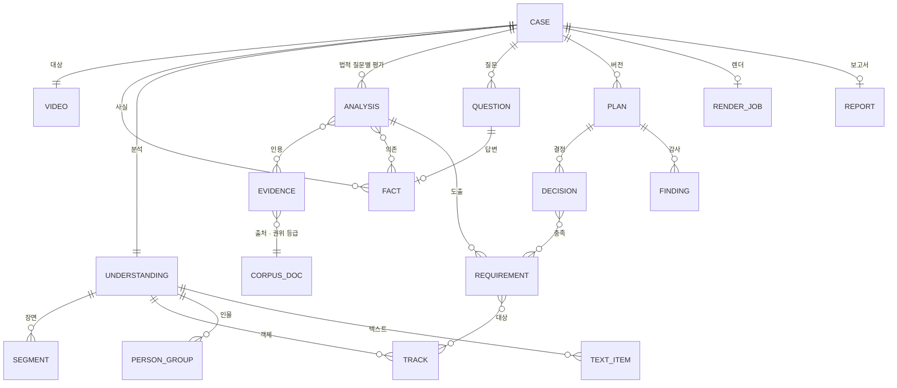

> PrivFrame 2.0 설계·PRD v2(승인본 2026-11-05)의 일부. 전체 목차와 다이어그램 검증 기록은 [README.md](./README.md).

## 8. 도메인 모델

### 8.1 용어 (초안. 기준은 `GLOSSARY.md`)

| 용어 | 정의 |
|---|---|
| Case | 영상 1건의 비식별화 작업. 하나의 그래프 thread. 저장 투영은 기존 run 레코드 계승 |
| Fact | 판단에 쓰이는 사실 `{key, value, provenance, confidence}`. 키는 개방형(정규화 규칙만 둠) |
| Observation / VideoUnderstanding | 지각 도구의 구조화 산출물(장면·트랙·인물·텍스트) |
| Target | 비식별 대상이 될 수 있는 트랙·인물·텍스트 항목 |
| Question of Law / Analysis | 에이전트가 세운 법적 질문과 적용 가능성 평가(근거 인용·의존 사실·대상·구간) |
| Requirement | 분석에서 도출된 보호 요건(무엇을 어느 수준으로 어느 구간에). Planner의 입력, Auditor의 검증 기준 |
| Question | 에이전트가 생성한 사용자 질문(fact_key·형식·선택지·근거·영향) |
| Evidence | 코퍼스에서 가져온 근거 단위 + 인용 표기 + 권위 등급 + 시행일 |
| Decision / RedactionPlan | 대상×범위×처리(방식·형태)×구간×충족 요건×근거 / 결정 집합의 버전. 강도는 없음(방식별 고정 수준) |
| ReviewChange | Loop B의 사용자 변경(결정·사실·답변)과 안내된 위험 |
| Finding / AuditReport | Auditor의 발견(유형·심각도·대상·근거·권고·해결 상태) |
| RenderJob | PTS 맵·결정 → 원본 렌더 작업과 검증 지표 |
| Report | 초 단위 스크립트 + 요건·근거·질문·변경·감사·검증·출처 |
| Corpus Document / Chunk | 법률 자료(권위 등급·시행일·개정 이력·출처) / 검색 단위 |
| Profile / Experiment | 어댑터·모델·파라미터 조합 / 프로필×데이터셋×그래프·프롬프트 버전의 평가 실행 |

### 8.2 관계 (D7)

### 8.3 시간·저장·검색 단위
시간은 **원본 PTS(초, time_base 병기)** 가 기준이고 프록시 프레임 인덱스는 PTS 맵을 통해서만 쓴다. 저장은 레코드(SQLite→Postgres) + artifact JSON + 체크포인트(참조만) + 인덱스. 검색 단위는 §9.3. ADR 후보: (1) 요건 1급 객체화와 근거 필수 계약 (2) 원본 스트림 렌더·프록시 분석 (3) 에이전트 루프 + 결정적 검증기 (4) 택소노미의 비구속 역할 (5) core/harness/service 분리.

