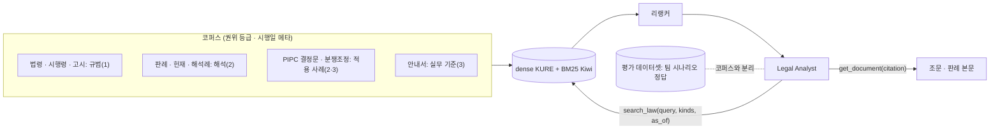

> PrivFrame 2.0 설계·PRD v2(승인본 2026-11-05)의 일부. 전체 목차와 다이어그램 검증 기록은 [README.md](./README.md).

## 9. 법률 RAG 전략

### 9.1 코퍼스 구성: 자료별 필요 이유·역할·권위·수집·유지보수

| 자료 | 역할 | 권위 등급 | 공식 출처·수집 | 최신성·개정 | 검색 적합성·청킹 | 유지보수 | 결정 |
|---|---|---|---|---|---|---|---|
| 법률·시행령·시행규칙 | 적용 요건의 규범 | 1(구속) | law.go.kr Open API `lawjosub`(조문 단위, 시행일·개정 이력) | 시행일 필터, 연혁 API | 조 단위 + 계층 접두어, 긴 조는 항 자식 | 낮음(API 자동) | **필수** |
| 고시(표준 개인정보 보호지침) | 영상정보 운영 세칙 | 1 | API `admrul` | 발령·시행일 | 조 단위 | 낮음 | **필수** |
| 판례(대법원·하급심)·헌재결정 | 초상권·이익형량·공개 장소·언론 예외의 해석 기준 | 2(해석) | API `prec`/`detc`(판시사항·판결요지·참조조문) + PIPC 판례집 선별 | 선고일, 후속 판례 | 판시사항·판결요지 각 1단위 + 이유 창 | 중(선별 기준 유지) | **필수(선별)** |
| 법령해석례 | 법제처 유권해석 | 2 | API `expc` | 해석일 | 질의요지·회답 | 낮음 | 선택 |
| PIPC 의결서·결정문 | 집행 사례·해석 | 2 | API `ppc` + 의결서 게시판(영상 관련 선별) | 의결일 | 사건개요·판단·결정 섹션 | 중 | **권장** |
| 분쟁조정 사례집 | 실무 적용 사례(비구속) | 3(참고) | PIPC 게시판 PDF | 연도판 | 사례 1건 | 낮음 | **권장(Review Guide 유사 사례)** |
| 안내서·가이드라인 | 실무 기준(비식별 수준, 이동형·고정형 운영) | 3(참고, PIPC 발행) | PIPC 게시판 PDF(현행판: 가명 2026.3, 이동형 2024.9, 고정형 2024.12, 아동·생체 2024.12, 생성형 AI 2025.8) | 판본 메타, 구판 교체 | 제목 계층 섹션·Q&A | 중(판본 추적) | **필수** |
| 팀 작성 시나리오·정답 | 평가·회귀용 | 0(권위 없음) | 팀 | — | — | — | **코퍼스 제외 → 평가 데이터셋** |
| 영어 자료(GDPR 등) | 비교 참고 | 0 | — | — | — | — | 제외(혼동 방지) |

인용·권위 규칙: 근거는 `authority ∈ {1,2,3}`와 `effective_from/to`를 가지고, 에이전트는 권위 1·2 없이 권위 3만으로 "의무"를 단정할 수 없다(검증기 규칙). Review Guide의 "유사 사례"는 권위 2·3의 **실제 사례**만 보여 준다.

### 9.2 검색·에이전트 도구화 (D8)

- 하이브리드(KURE dense + Kiwi 형태소 BM25, RRF) → KURE-Reranker-nano → 권위·시행일 필터 → 부모 단위 승격(조/판결요지). `reranker: none` 프로필과 비교(LegalBench-RAG의 리랭커 역효과 보고 때문).
- 질의는 **에이전트가 생성**(질문별 다수 질의, 유형 지정 가능). v1의 "유형별 할당량" 같은 고정 규칙은 두지 않고, 대신 검색 결과에 유형 분포를 표기해 에이전트가 보완 검색을 판단한다.
- 인덱스는 문서 집합·설정 fingerprint로 고정(기존). 반사실 코퍼스는 별도 인덱스 + `as_of`·문서 제외 옵션.

### 9.3 청킹 (리서치 근거 §10.3)
법령: 조 단위 + "법령명 › 장 › 조(제목)" 접두어, 800토큰 초과 시 항 자식·부모=조. 판례: 판시사항·판결요지 각 1단위, 이유 400~500토큰 창, 부모=헤더+판결요지. 결정례: 섹션. 안내서: 번호 제목 단위 500~800. 문맥 문장(Contextual Retrieval)은 실험 변수.

## 11. 법적 프레임과 프로토타입의 준수

### 11.1 이 시스템의 "개인영상정보" 정의
표준지침 제2조제9호(개인의 초상·행동 등 영상으로 해당 개인을 식별할 수 있는 정보) + 법 제2조제1호 나목(다른 정보와 **쉽게 결합**하여 알아볼 수 있는 정보; 결합 용이성은 시간·비용·기술·입수 가능성을 합리적으로 고려). 적용: 직접 식별자(얼굴·차량등록번호·성명 텍스트/자막), 간접 결합(전신·복장·소지품·문신·장소·시간), 음성(복원 가능, v1 고지). 식별 가능성은 **공개 범위에 따라 달라지므로** 사실(audience)이 판단에 들어간다(이것이 질문이 필요한 이유).

### 11.2 핵심 근거(검증됨)
제2조·제15·17·18·22조의2·23조·25조·25조의2·26조·28조의2~8·58조·58조의2, 시행령 제3·18·22~27조, 표준지침 제36~48조; 대법원 2004다16280(초상권 범위), 2012다31628(공적 관심사·증명책임), 2020다227455(이익형량·증거 촬영·전송 범위), **2020다253423**(언론 보도의 초상권 침해: 공적 인물·공적 관심사면 위법성이 조각될 수 있음, 파기환송), 2021다219116(촬영 동의의 범위를 넘는 공표에는 별도 동의), 헌재 2015헌마994. PIPC 비정형 기준: 눈·코·입 식별 불가 거리는 저위험이나 흉터·문신 등은 고위험, 모자이크 AI 복원 가능, 공개는 익명정보 수준 원칙, "사람과 컴퓨터가 식별 불가능한 수준".

> **정정 (2026-11-11)**: 승인본은 2020다253423을 "얼굴을 가려도 자막·문맥으로 식별되면 침해"로 요약하고 텍스트·자막 가림의 근거로 썼다. 판결문을 다시 읽은 결과 이 판결은 위법성이 조각될 여지가 충분하다며 원심을 파기환송한 것이고, 해당 문장은 얼굴 공개로 인한 추가 피해가 크지 않다는 이유로 쓰였다. 명찰·자막 가림의 근거는 법 제2조제1호(가목 성명, 나목 결합)와 안내서로 바꾼다. 2020다227455는 상고기각(증거 촬영과 제한된 전송을 위법성 조각 사정으로 인정), 2021다219116은 파기환송으로 요약이 맞다. 2004다16280 · 2012다31628 · 2015헌마994는 인용으로만 확인된 상태다([12-corpus-plan-draft.md](./12-corpus-plan-draft.md) §A).

### 11.3 참고 패턴(체크리스트용, 비구속)
v1 I01~I17을 패턴으로 보존: 제3자 얼굴(공개 범위별), 아동, 민감 맥락, 간접 결합, 텍스트·자막, 번호판, 이동형 촬영 고지, 고정형 제공·열람, 초상권·영리 이용, 언론·공익 예외, 본인 열람, 동의 상태·범위, 가명·익명 수준, 사적 공간, 본인, 고정형 적용 제외, 증거 촬영 형량.

### 11.4 프로토타입 자체의 데이터 보호
외부 VLM/LLM = 수탁자(제26조)·국외이전(제28조의8①3호) → 동의받은 출연자·합성 영상만, 전송 최소화(§7.3), ZDR, 처리 내역 기록, 시연용 처리방침 문구. 얼굴 특징 벡터는 식별 목적 생체인식정보에 해당할 수 있어 **케이스 완료 시 삭제**, 보고서·API 비노출. LangSmith trace에는 프레임·특징 없이 참조만.

