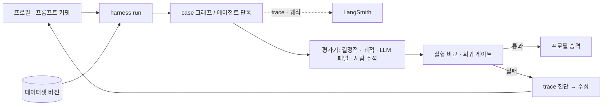

> PrivFrame 2.0 설계·PRD v2(승인본 2026-11-05)의 일부. 전체 목차와 다이어그램 검증 기록은 [README.md](./README.md).

## 12. 테스트·평가 전략

### 12.1 하네스 (D9)

LangSmith 구성은 §10.5(프로젝트 3개, 노드·에이전트별 데이터셋, `config_hash`·프롬프트 커밋 메타데이터, 반복 3회, 쌍대 비교, 주석 큐, pytest 게이트).

### 12.2 데이터셋과 지표

> 지금 구현된 것은 점수의 형식 · 저장 · 집계와 평가기 등록표뿐이다([16 §16.6](./16-lab-runs-and-experiment-sets.md)). 아래 지표는 설계 시점의 후보이며 팀의 평가 설계에서 확정한다. 렌더·I/O 행의 "가림 영역 재검출률"은 M4 측정으로 "재식별 불가" 기준이 되었다([14 §14.6](./14-m4-build.md)).

| 대상 | 데이터셋 | 정량 지표 | 정성·LLM-judge |
|---|---|---|---|
| 지각 | 팀 영상 + 정답 박스/텍스트/인물 | 검출 P/R, 트랙 ID 전환, OCR 정확도, 그룹화 오병합/분할 | — |
| VLM 장면 설명 | 장면별 정답 라벨(장소·활동·아동·민감) | 라벨 일치율(V-1/V-2/V-3 비교) | 설명 루브릭 |
| Legal Analyst | 시나리오 13종 × 정답 요건·인용(팀 작성, 교수 검토) | 요건 재현율/정밀도, 인용 유효율, 근거 연결 정확도, 도구 호출 수, 질문 수·적절성, 커버리지 경고율, 신규 쟁점율 | 분석 타당성 루브릭(패널), 사람 검토 |
| 동적 질문 | 시나리오별 "필요한 사실" 정답 | 필요 사실 재현율, 불필요 질문 비율, 라운드 수 | 질문 문구 품질 |
| Planner | 정답 계획 | 정책 F1(대상×액션×범위), 범위·구간 정확도, 요건 충족률 | — |
| Auditor | 결함 주입 계획 | 탐지율, 오탐률 | — |
| 렌더·I/O | 모든 케이스 | 프레임 수·PTS·오디오 framemd5·메타 diff 일치, 마스크 외 PSNR/SSIM(임계 U9), 가림 영역 재검출률, VMAF(참고) | — |
| 전체 | e2e 시나리오 | 누락률(미가림 PII), 과잉 가림률(유용성), 비용, 지연, **반사실 변경률/불변성** | 보고서 품질, 교수 평가 |

베이스라인 비교(정책 F1·누락률·변경률): static · rule_based · llm_only · naive_rag(1회 검색·고정 질문) · proposed(Arch-C). 반사실 코퍼스 5종(판본 교체, 제25조의2 제거, 가상 엄격 조문, 판례 결론 반전, 자막 유무).

### 12.3 개선 여부의 검증
각 변경(동적 질문, 에이전트 루프, 하이브리드 검색, 리랭커, 사전 블러, 원본 렌더)은 **프로필 변수**로 켜고 끌 수 있어야 하며, 같은 데이터셋에서 쌍대 비교로 효과를 보고한다. 실패 상황(질문 남발, 루프 과다, 인용 오류, 블러로 인한 설명 저하, 렌더 검증 실패)은 지표로 즉시 드러난다.

