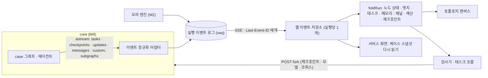

> PrivFrame 2.0 설계·PRD v2(승인본 2026-11-05)의 일부. 전체 목차와 다이어그램 검증 기록은 [README.md](./README.md).

## 10. 화면: 서비스와 실험실 (M2 구현, 2026-11-06)

### 10.1 결정과 배경

2026-11-06 사용자 검수에서 세 가지가 정해졌다. ① 목업은 캔버스가 아니라 **실제 웹 화면으로 구현**하고 사용자가 브라우저로 확인한다. ② **처리 강도 조절 기능은 없앤다**(ADR-0007). ③ 화면을 두 영역으로 나눈다. **서비스**는 업로더가 영상을 넣고 출력까지 가는 흐름이고, **실험실**은 LLMOps 기능을 한곳에 모은 연구자 영역이며, 중심 화면은 노드·엣지로 그린 **멀티에이전트 토폴로지**다. 토폴로지는 에이전트의 메모리와 태스크 흐름을 실시간으로 보여 준다.

M2에서는 화면이 같은 API 계약을 흉내 내는 **모의 백엔드**로 동작했다(ADR-0008). M4부터 같은 계약을 FastAPI(`service/app.py`)가 구현하고 화면 코드는 그대로 쓴다. 모의 백엔드는 키 없이 화면을 볼 때와 화면 테스트에 계속 쓴다.

같은 날 두 번째 검수 지시로 **프로필**을 다시 정의했다. 프로필은 파이프라인의 교체 가능한 부품(VLM · LLM · 검색 알고리즘 · 검출기 · 인코더 등 27개)마다 후보 하나를 고른 조합이다. 실험실에서 프로필을 만들고, 그 프로필로 실행(토폴로지)과 실험(회귀 게이트)을 돌리고, 통과하면 서비스에 적용한다. 후보는 한 파일(`configs/pipeline/catalog.yaml`)에 모으고, 등록된 계열이면 실험실 화면에서 바로 추가한다(§10.8, ADR-0009).

### 10.2 실행 방법

```bash
cd frontend
npm install
npm run dev          # http://127.0.0.1:5180  (모의 백엔드가 같은 포트에서 /api 제공)
npx playwright test  # 모의 백엔드(5181) + 고정 응답으로 띄운 실제 백엔드(8012 · 5182, uv와 ffmpeg 필요). 개수는 16 §16.8
```

- 실제 백엔드(M4)에 붙이는 방법과 화면에서 달라지는 점(실제 영상 미리보기, 멈춤 · 계속, 실험 화면의 "아직 연결되지 않음")은 [14-m4-build.md §14.5](./14-m4-build.md)에 있다. `PRIVFRAME_E2E_REAL=0`이면 실제 백엔드 테스트를 건너뛴다.

- 5173 포트는 다른 로컬 프로젝트와 겹쳐 5180으로 고정했다.
- 실제 백엔드 연결(M4): `PRIVFRAME_API=proxy PRIVFRAME_API_URL=http://127.0.0.1:8000 npm run dev`.
- 모의 백엔드는 실행·실험을 메모리에만 두므로 개발 서버를 다시 시작하면 목록이 비고, 시작할 때마다 가상 시계로 계산한 **기록된 데모 실행** 1건과 서비스 프로필의 **기준 실험** 1건이 만들어진다.
- 프로필·후보·서비스 적용은 `configs/pipeline/`의 파일에 바로 기록된다(개발 서버 기준). 테스트는 `PRIVFRAME_PIPELINE_SANDBOX=1`로 임시 사본을 쓰므로 저장소 파일을 바꾸지 않는다. 다른 폴더를 쓰려면 `PRIVFRAME_PIPELINE_DIR`.

### 10.3 화면 목록

> 2026-11-11 · 11-12에 바뀐 화면은 §10.10 · §10.11을 본다. 이 표에서 달라진 것: 계획 검토는 유지 / 모자이크만 고르고 대안은 없다. 출력 검증은 10~11행이다. `/lab`은 실행 목록이고 토폴로지는 `/lab/runs/:id`다. 체크포인트 분기는 없어졌다. `/lab/experiments`는 구간 실험이고 프로필 비교 실험은 `/lab/experiments/pipeline`이다.

| 영역 | 경로 | 화면 | 설계 근거 |
|---|---|---|---|
| 서비스 | `/` | 새 작업: 영상 선택(브라우저에서 길이·해상도·썸네일 확인), 선택적 상황 메모, 장면 분석 방식(V-2 기본 / V-3), 처리 고지 동의, 최근 작업 | FR-01, FR-04, §5.3, §7.3, §11.4 |
| 서비스 | `/cases/:id` | 케이스 작업 공간. 7단계 진행 표시(업로드 · 영상 분석 · 대상 확인 · 법적 판단 · 계획 검토 · 감사 · 결과)와 상태별 화면 | §5.7 상태 머신 |
| 서비스 | 〃 분석 중 | 진행 기록(활동 피드), 지금까지 찾은 것, 알고 있는 사실 | FR-02, FR-03 |
| 서비스 | 〃 대상 확인 | 묶음이 불확실한 인물 1건만 질문. 본인·제3자·동의는 묻지 않음 | §5.7 await_identity |
| 서비스 | 〃 질문 | 에이전트가 만든 질문, 묻는 이유(근거·인용), 답별로 달라지는 처리, 모름·나중에, 이미 아는 사실, 게이트가 뺀 질문 | FR-06, §5.3 |
| 서비스 | 〃 계획 검토 | 예시 장면 미리보기·결정 타임라인, 위험 순 결정 카드(방식·형태·구간 편집, 근거·유사 사례·수정 시 위험·대안), 사실 수정 → 재평가, 미답 질문 늦은 답변 → 재평가 | FR-07, FR-08, §5.6 |
| 서비스 | 〃 감사 | 발견(남은 식별 단서·요건 미충족·과잉 처리), 권고 적용 또는 사유 있는 거부(위험 수용), 요건 충족 점검, 계획으로 돌아가기 | FR-09 |
| 서비스 | 〃 렌더 · 결과 | 원본 스트림 렌더 단계, 출력/원본 미리보기, 출력 검증 8항목, 초 단위 스크립트, 질문·수정·감사 기록, 고지, 인용, 보고서 JSON 내려받기 | FR-10, FR-11, NFR-09 |
| 실험실 | `/lab`, `/lab/runs/:id` | 멀티에이전트 토폴로지(실시간·재생), 검사기(에이전트 메모리 · 노드 · 이벤트 · 체크포인트 분기), 태스크 흐름(간트) | FR-16 |
| 실험실 | `/lab/runs` | 실행 기록(서비스 · 데모 · 실험 실행 필터, 프로필 · 실험 링크) · 평가 실행 요약, 프로필을 골라 데모 실행 시작 | FR-12, FR-16 |
| 실험실 | `/lab/experiments` | 실험 목록, 새 실험(프로필 1~4개 · 기준 · 데이터셋 · 반복) | FR-17, §12 |
| 실험실 | `/lab/experiments/:id` | 계산된 실험: 프로필별 회귀 게이트, 지표 비교(기준 대비 Δ), 정답 계획과 다른 결정과 원인, 실행한 시나리오, 모의 실행 규칙, 실행 목록 → 토폴로지. 예시 실험(M5 형식): 전략 비교 · 히트 테이블 · 반사실 · ablation | FR-17, §12 |
| 실험실 | `/lab/datasets` | 데이터셋(팀 시나리오는 평가 데이터로만) · 평가기(결정적 · 궤적 · LLM 패널 · 사람), 서비스 프로필의 최근 실험 값 | FR-17, ADR-0006 |
| 실험실 | `/lab/profiles`, `/lab/profiles/:id` | 프로필 목록(게이트 · 서비스 적용 · 추정 비용), 상세(부품 27개 · 예산 · 검사 결과 · 기준 프로필과 다른 부품), 이 프로필로 실행 · 실험 시작 · 복제 · 서비스에 적용 · 삭제, 두 프로필 비교 | FR-17, NFR-04, ADR-0009 |
| 실험실 | `/lab/profiles/new`, `/lab/profiles/:id/edit` | 프로필 편집기: 단계별 부품 선택, 예산 · 설정, 실시간 검사와 추정 비용, 저장 · 저장하고 실행 | FR-17, ADR-0009 |
| 실험실 | `/lab/catalog` | 모델 후보: 부품별 후보 표(실행 위치 · 단가 · 라이선스 · 근거 · 쓰는 프로필), 화면에서 후보 추가(OpenRouter 자동 채움), 어댑터 계열 | FR-17, ADR-0009 |

서비스 화면 머리에 **실험실에서 보기** 링크가 있어 같은 케이스의 토폴로지로 바로 넘어간다. 두 탭을 나란히 열면 서비스에서 답하는 순간 토폴로지에서 `ask_user → 질문 답변` 엣지와 에이전트 메모리가 갱신되는 것을 볼 수 있다.

### 10.4 멀티에이전트 토폴로지

- **그래프**: D4 case 그래프를 그대로 그린다. 결정적 노드, 사람 노드(interrupt), 에이전트 그룹(Legal Analyst · Auditor) 안의 추론 노드와 도구 노드, 인용 검증기, 지각 서브그래프(열기 → 8단계와 병렬 분기)로 구분한다. 행이 긴 그래프는 두 줄로 접고 줄바꿈 엣지로 잇는다.
- **실시간 상태**: 실행 중(청록 테두리), 사람 응답 대기(호박색), 완료, 캐시, 오류를 아이콘과 글자로 함께 표시한다. 방금 지나간 엣지는 점이 흐르고, 도구 엣지에는 호출 횟수(×n)가 붙는다. 에이전트 그룹에는 예산(도구 · 검색 · 질문 라운드 · 재시도) 사용량 막대가 있다.
- **에이전트 메모리**: 에이전트를 고르면 스레드 체크포인트에 쌓이는 메시지(시스템 · 입력 · 모델 · 도구 호출 · 도구 결과), 예산, 그 에이전트가 쓴 상태 채널을 실시간으로 보여 준다. 아무것도 고르지 않으면 케이스 상태 채널 전체(버전 · 마지막 작성 노드 · 이력)를 보여 주고, 장기 메모리(Store)는 M6 전까지 비어 있다고 밝힌다.
- **태스크 흐름**: 단계·행위자별 레인(수집 · 지각 · 사람 · Analyst 추론/도구 · 계획 · Auditor 추론/도구 · 렌더)에 태스크 막대를 그리고, 병렬 태스크는 레인 안에서 줄을 나눈다. 사람 대기는 빗금 막대다.
- **재생과 분기**: 이벤트 순번으로 되감아 그 시점의 상태를 다시 계산한다. 체크포인트 탭은 목록만 보여 준다. 부품을 바꿔 이어 실행하는 일은 구간 실험이 한다(§10.11).
- **프로필 표시**: 실행 바에 실행한 프로필(config_hash)과 그 프로필의 비용 상한을 보이고, 노드에는 고른 부품 이름이 붙는다(예: 추론 노드 = 분석 모델, `search_law` = 임베딩 · 검색 방식 → 리랭커, 검출·추적 = 얼굴 검출 · 사람 검출 · 추적기). 개요 탭은 부품 27개를 단계별로 보여 준다.
- **보기 조작**: 진행 중인 실행은 실행 중인 노드를 따라가고, 끝난 실행은 전체를 한 화면에 맞춰 연다. 미니맵은 필요할 때 켠다.

### 10.5 데이터 계약 (D10)

화면은 [`frontend/src/api/contract.ts`](../../frontend/src/api/contract.ts)의 타입만 쓴다.

- REST: `GET/POST /api/cases`, `GET /api/cases/{id}`, `POST /api/cases/{id}/identity · answers · facts · review · audit`, `GET /api/cases/{id}/report.json`, `GET /api/lab/graph · runs · datasets · settings`(settings는 모의 백엔드의 재생 속도, 실제 백엔드에는 없다), `POST /api/lab/runs`(데모, `profileId` 선택). 2026-11-11 이후 더해진 계약(구간 · 평가기 · 구간 실험 · 영상 데이터셋 · 미리보기 영역 · 멈춤/계속)은 [14 §14.5](./14-m4-build.md), [16 §16.7](./16-lab-runs-and-experiment-sets.md)에 있다.
- 프로필 · 카탈로그 · 실험: `GET /api/lab/catalog`, `GET /api/lab/catalog/lookup?ref=`(OpenRouter 공개 목록), `POST /api/lab/catalog/candidates`, `DELETE /api/lab/catalog/candidates/{slot}/{id}`(실험실에서 추가한 후보만), `GET/POST /api/lab/profiles`, `GET/PUT/DELETE /api/lab/profiles/{id}`, `POST /api/lab/profiles/check`(저장 전 검사 · 추정 비용), `POST /api/lab/profiles/{id}/promote`(게이트 통과 시), `GET/POST /api/lab/experiments`, `GET /api/lab/experiments/{id}`.
- 실시간: `GET /api/runs/{id}/events` (SSE). 이벤트마다 `id: seq`를 실어 끊겼다 다시 붙을 때 `Last-Event-ID`부터 이어 받는다. 웹은 실행당 EventSource 하나를 공유하고, 몰려오는 이벤트를 화면 프레임 단위로 묶어 그린다.



그림의 'POST fork' 화살표(체크포인트 분기)는 2026-11-12에 없어졌다(§10.11).

정규화 이벤트와 M4에서 채울 LangGraph 출처(가정 U11, M3 스모크에서 확인):

| 이벤트 | 뜻 | M4 출처 |
|---|---|---|
| `run.start` · `run.status` · `run.end` | 실행 메타 · 서비스 상태 | 실행 래퍼 · 그래프 상태 |
| `node.start` · `node.end` | 태스크 시작 · 끝(결과 ok/cached/error, 비용, 쓴 채널) | `stream_mode="tasks"` + `subgraphs=True` 네임스페이스 → `에이전트/노드` |
| `edge` | 엣지 통과(fwd/back) | 다음 태스크의 triggers, 도구 호출은 AIMessage tool_calls |
| `llm` | 모델 호출(입력 · 캐시 입력 · 출력 토큰, 비용) | 콜백 usage_metadata · LangSmith run |
| `tool.call` · `tool.result` · `message` | 에이전트 작업 메모리 | `messages` 스트림 |
| `state` | 상태 채널 쓰기(작성 노드) | `updates` 스트림 |
| `interrupt` · `resume` | 사람 대기와 재개 | `__interrupt__` 업데이트 · `Command(resume=)` |
| `checkpoint` | 체크포인트 id · step · next | `stream_mode="checkpoints"` |
| `budget` · `validator` · `activity` | 예산 사용량 · 검증 결과 · 사용자용 진행 문장 | `custom` 스트림(`get_stream_writer`) |

### 10.6 모의 백엔드 (`frontend/mock/`)

| 파일 | 역할 |
|---|---|
| `plugin.ts` | Vite 개발·미리보기 서버에 `/api`와 SSE를 붙인다. `PRIVFRAME_API=proxy`면 꺼진다 |
| `engine.ts` | 실행 하나 = `CaseRun`. 벽시계(실시간)와 가상 시계(기록된 데모) 두 모드, interrupt 대기·자동 응답, 프롬프트 캐시를 반영한 비용 계산 |
| `flow.ts` | D4 그래프를 따라 이벤트를 내는 대본. 답변·사실 수정·검토 변경이 분석 → 요건 → 결정에 실제로 반영된다 |
| `scenario.ts` | 예시 시나리오(카페 인터뷰 01:12). 법령·판례 식별자는 R6에서 확인한 것만 쓰고, 분쟁조정 사례는 자리 표시로 밝힌다 |
| `graph.ts` | 토폴로지 노드·엣지와 배치. 실제 백엔드는 같은 내용을 `backend/src/privframe/service/data/graph.json`으로 두고 `GET /api/lab/graph`로 준다 |
| `stage.ts` | 구간 실험 · 영상 데이터셋 · 평가기 · 단계 결과 저장소의 모의 구현 |
| `http.ts` | 모의 API의 HTTP 도우미 |
| `pipeline.ts` | `configs/pipeline`의 카탈로그 · 프로필 · 서비스 포인터를 읽고 쓴다. 프로필 검사, 부품 해석, config_hash |
| `experiments.ts` | 프로필 × 반복 실행을 가상 시계로 돌리고 정답 계획과 비교해 지표 · 게이트 · 결정 차이를 낸다 |
| `openrouter.ts` | 후보 추가 때 OpenRouter 공개 모델 목록에서 단가 · 기능을 읽는다(10분 캐시, 키 불필요) |
| `lab-data.ts` | 예시 실험(M5 형식) · 데이터셋 · 평가기 · 평가 실행 요약의 **예시 수치**. 화면에 예시 값임을 표시한다 |

정직성 표시: 머리말의 **모의 데이터** 배지, 미리보기의 **예시 장면**(SVG 일러스트), 실험 화면의 **예시 값** 배너, 비활성화한 출력 영상 내려받기(모의 백엔드는 영상을 만들지 않는다).

### 10.7 디자인 원칙

- 서비스는 밝은 "근거 장부" 톤, 실험실은 어두운 계기판 톤으로 두 영역을 구분한다. 글꼴은 Pretendard와 시스템 고정폭이며 한글은 단어 단위로 줄을 바꾼다.
- 처리 방식 색(유지 · 모자이크 · 삭제)은 dataviz 검증 스크립트로 색각 이상·명도·채도 기준을 모든 쌍에서 통과한 팔레트다. 글자는 잉크색을 쓰고 색은 견본·막대가 맡는다.
- 상태는 아이콘과 글자를 함께 쓰고, 근거는 권위 등급(규범 · 해석 · 참고) 꼬리표를 붙인다. 표의 수치에는 인라인 막대를, 시나리오 표에는 단일 색상 순차 히트를 쓴다.
- 1440px와 390px 폭에서 가로 넘침이 없음을 확인했다.

### 10.8 프로필 · 부품 카탈로그 · 실험 (ADR-0009)

**프로필은 부품마다 후보 하나를 고른 조합이다.** 부품 27개(지각 8 · 장면 이해 4 · 법률 검색 7 · 에이전트 · LLM 7 · 렌더 1)와 예산 · 설정 12개로 이뤄진다.

| 파일 | 내용 | 쓰는 쪽 |
|---|---|---|
| `configs/pipeline/catalog.yaml` | 부품(slot)과 후보(candidate), 어댑터 계열, 예산 · 설정 범위. 후보마다 실행 위치 · 단가 · 기능 · 라이선스 · 근거(R1~R7, 단가는 2026-11-06 OpenRouter 목록) | 사람이 편집 · 실험실 '후보 추가'가 기록 · M4 백엔드가 읽음 |
| `configs/pipeline/profiles/*.yaml` | 프로필 하나 = 부품별 후보 ID + 파라미터 | 실험실 편집기 · 사람 |
| `configs/pipeline/service.yaml` | 서비스 기본 프로필과 '이 컴퓨터에서만 처리' 프로필 | 실험실 '서비스에 적용'(게이트 통과 시) |

- 파일이 바뀔 때마다 다시 읽으므로 서버를 다시 켤 필요가 없다. 화면에서 고친 내용은 같은 파일에 기록되며, 직렬화 형식을 손으로 쓴 파일과 맞춰 추가한 줄만 diff에 남는다(읽고 다시 쓴 결과가 원본과 같음을 확인).

**후보 추가는 화면 우선, 새 계열은 코드.** 등록된 어댑터 계열(OpenRouter · Gemini API · sentence-transformers · CrossEncoder · rfdetr · RapidOCR 등)의 다른 모델은 화면에서 바로 추가된다. OpenRouter 모델은 slug만 넣으면 공개 모델 목록(키 불필요, 무료)에서 단가 · 입력 형식 · 도구/JSON 지원을 채운다. 부품이 요구하는 기능이 없으면 거절한다(예: Legal Analyst는 도구 호출, 장면 설명은 JSON 스키마 출력). 구조가 다른 새 계열은 어댑터 코드가 있어야 실행할 수 있으므로 코드를 먼저 만들고 파일의 `adapters`에 등록한다. 로컬 모델은 첫 실행 때 가중치를 내려받는다.

**검사와 추정 비용.** 서버가 저장 전에 확인한다: 카탈로그에 없는 후보 · 구현 예정 후보 · 부품이 요구하는 기능 · V-3(로컬만)인데 외부 VLM이면 오류, 감사자가 분석가 · 계획자와 같은 회사 모델이거나 AGPL · 비상용 라이선스면 주의. 오류가 있으면 저장하거나 실행할 수 없다. 추정 비용은 예시 영상 1건을 그 설정으로 가상 시계에서 조용히 실행해 계산한다(config_hash별 캐시).

**실험.** 프로필 1~4개 × 데이터셋 × 반복(1~3)을 실행하고 정답 계획과 비교해 정책 F1 · 누락률 · 과잉 처리율 · 구간 오류 · 요건 재현율/정밀도 · 인용 유효율 · 질문 수 · 도구 호출 · 비용 · 지연(사람 대기 제외)을 낸다. 회귀 게이트(F1 ≥ 0.85 · 누락률 ≤ 3% · 인용 유효율 100% · 비용 ≤ $0.30)를 **현재 config_hash로** 통과한 프로필만 서비스에 적용할 수 있고, 프로필을 고치면 다시 실험해야 한다. 정답과 다른 결정은 실행 기록에 남은 원인과 함께 보여 준다. 실험 실행은 실행 기록과 토폴로지에서 그대로 열린다. 모의 엔진은 시나리오 13개 중 S01만 실행하고, 나머지는 실제 파이프라인의 평가 실험(M5)에서 돈다.

**모의 실행 규칙 (M2 전용).** 프로필 선택이 실행을 어떻게 바꾸는지는 `mock/flow.ts`의 규칙으로 정했고, 실험 화면에 같은 문장을 보여 준다.
- 경량 Legal Analyst는 참고 패턴 · 아동 확인을 건너뛰고 명찰 요건(REQ-2)을 놓친다(커버리지 경고는 아동 확인만 되돌림).
- 상위 Auditor는 문신(F-1) · 번호판 구간(F-2) · 유지로 남은 명찰 · 번호판(F-4 · F-5)을 찾고, 경량 Auditor는 요건 대조와 번호판 구간만 본다. '감사 생략'은 감사를 건너뛴다.
- 임베딩 LawIRKo < 0.75, 리랭커 없음, 하이브리드가 아닌 검색은 각각 재검색 1회. 시드 묶음을 끄면 핵심 조문 검색 2회.
- 동적 질문을 끄거나 라운드 상한이 0이면 묻지 않고 보수적으로 가정한다. 라운드당 질문 상한을 넘는 질문은 버린다.
- 도구 · 검색 예산이 바닥나면 남은 단계를 건너뛰고 제출한다. 재시도 상한 0이면 인용 표기 오류가 미해결로 남는다. 경량 Planner는 계획 검증에 한 번 실패한다.
- 번호판 검출기를 끄면 번호판을 가릴 수 없고, 윤곽 마스크를 끄면 과잉 가림 권고(F-3)를 적용할 수 없다. 로컬 VLM은 비용 0 · 느림. 검출기 · 인코더는 소요 시간만 바꾼다. 반복 실행은 시드에 따라 지연 ±8% · 토큰 ±5~10%가 다르다.

측정 예(2026-11-06, S01 · 반복 2회, 모의): baseline-v2 F1 1.00 · $0.210 통과 / budget-saver F1 0.67(명찰 · 문신 누락) · $0.069 미달 / local-only F1 1.00 · $0.200 통과(지연 +11 s) / research-max F1 1.00 · $0.336 미달(비용).

### 10.9 검증 기록 (2026-11-06)

- `tsc`와 `vite build` 통과. 실험실은 지연 로딩되어 서비스 첫 화면 번들에 React Flow가 들어가지 않는다.
- Playwright 5개 통과: 예시 영상 → 대상 확인 → 질문 → 검토(강도 컨트롤 없음 확인) → 감사 → 결과 / 늦은 답변이 D-4만 바꾸는지 / 기록된 데모의 토폴로지 · 에이전트 메모리 · 재생 / 실시간 데모에서 노드가 켜지는지 / 실험 · 데이터셋 · 프로필 화면.
- 브라우저 자동 조작으로 전 과정을 캡처해 화면을 직접 검토했고 콘솔 오류는 0건이었다.
- 프로필 · 카탈로그 추가 후: Playwright 8개 통과(기존 5개 + 카탈로그 부품으로 프로필을 만들어 실행하면 토폴로지에 고른 모델이 보이는지 / 화면에서 추가한 후보가 편집기에 나오는지 / 실험이 정답 계획과 비교해 게이트 · 결정 차이를 내고 실행이 토폴로지로 열리는지 · 평가 전 프로필 승격이 거절되는지). 테스트는 5181 포트와 설정 사본에서 돌아 저장소 파일이 바뀌지 않음을 확인했다. OpenRouter 조회는 실제 공개 목록으로 확인했다(예: `z-ai/glm-5.3`).

### 10.10 M4 검수 반영 (2026-11-11, [15-m4-improvements.md](./15-m4-improvements.md))

- **검토 화면**: 화면의 대상은 유지 / 모자이크, 파일 정보(촬영 위치)는 유지 / 삭제만 고른다. 미리보기는 서버가 렌더와 같은 규칙으로 계산한 프레임별 영역(`GET · POST /api/cases/{id}/geometry`)을 그리며, 수정 중인 계획은 POST로 보내 같은 계산을 받는다. 입력한 구간과 실제 적용 구간이 다르면 실제 적용 구간을 함께 보여 준다. 파일 정보 결정은 타임라인 아래에 따로 나온다.
- **결과 화면**: 출력 검증의 행 수를 고정하지 않는다(보통 10행, 위치 태그를 삭제하면 11행). 초 단위 스크립트의 마지막에 "파일 전체" 행이 올 수 있다.
- **일부 구간만 실행한 케이스**(실험의 실행): 서비스 화면에서 열면 실험용 실행임을 알리고 실험실로 안내한다.
- **토폴로지**: 오른쪽 패널의 시간순 목록은 위에서 아래로 과거 → 최신이다. 실행 중에는 최신 기록을 따라가고, 노드를 고르면 그 노드의 첫 기록으로 이동해 그 노드의 기록만 표시한다. 체크포인트 분기는 그 지점부터 이어 가며(앞 단계는 다시 실행하지 않음), 재사용한 단계는 상태 채널 `reuse`에 표시된다.
- **실험 (`/lab/experiments`)**: 구간 실험이 기본 화면이다. 목록, 만들기(`/new`: 구간 범위 → 기준 프로필 → 부품별 비교 후보 → 영상 데이터셋 → 실행 수 · 분기 지점 · 다시 계산되는 단계 · 비용 상한 요약), 상세(`/:id`: 조합 비교표 → 단계별 실행/재사용 → 조합 × 영상 결과와 기준 대비 차이, 실행별 토폴로지 링크). 정답 채점용 전체 파이프라인 실험(M5)은 `/lab/experiments/pipeline`으로 옮겼다.
- **데이터셋 (`/lab/datasets`)**: 영상 데이터셋을 만들고(외부 전송 허용 여부, 기본 금지), 영상을 업로드하거나 기존 실행에서 가져오고, 메모 · 정답을 고친다(자동 응답용 답은 2026-11-12에 삭제, §10.11).
- 검증: Playwright 26개 통과(모의 20 + 고정 응답 백엔드 6). 추가된 것은 유지 · 모자이크만 나오는지, 마지막 프레임의 미리보기(끝 프레임 누락 회귀), 위치 태그 결정과 삭제 검증, 토폴로지 기록 순서와 노드 이동, 구간 실험 만들기 · 실행 · 재사용 표시, 영상 데이터셋 관리.

### 10.11 실험실 보완 (2026-11-12)

사용자 지시로 실험실의 메뉴와 구간 실험 화면을 바꿨다. 동작과 API는 [16-lab-runs-and-experiment-sets.md](./16-lab-runs-and-experiment-sets.md), 결정은 [ADR-0014](../adr/0014-experiment-sets-accumulate-runs-and-never-answer-for-the-user.md).

- **메뉴**: 실행 · 실험 · "데이터셋 · 평가기" · 프로필 · 모델 후보(다섯 개). "실행 기록"과 "토폴로지"가 "실행" 하나가 되었다. 실행은 실행 1건을 찾아 열어 보는 곳이고, 실험은 여러 실행을 구성하고 쌓아 비교하는 곳이다.
- **실행 (`/lab`, `/lab/runs`)**: 실행 목록이 실험실의 첫 화면이다. 행을 누르면 그 실행의 토폴로지(`/lab/runs/:id`)로 들어간다. 종류 필터(전체 / 서비스 · 데모 / 실험)와 "응답 대기만"이 있고, 사람의 응답을 기다리는 실행은 행에 표시된다. 데모 실행은 여기서만 시작한다.
- **토폴로지**: 위의 실행 선택 목록과 데모 실행 버튼이 없어지고 "← 실행 목록"과 실행 제목이 들어갔다. 실행이 사람을 기다리면 "서비스 화면에서 질문 답변" 같은 버튼이 주 동작이 된다. 없는 실행 주소는 "찾을 수 없습니다"와 목록 링크를 보여 준다. 체크포인트 탭은 목록만 보여 주고, 부품을 바꿔 이어 가는 일은 구간 실험으로 안내한다.
- **실험 목록 (`/lab/experiments`)**: 구간 실험 한 건이 한 행이다(범위, 직접 응답 표시, 조합 · 영상 수, 실행 진행과 응답 대기 수, 비용, 상태, 최근 변경).
- **새 구간 실험 (`/lab/experiments/new`)**: 범위(묻는 구간에는 무엇을 묻는지 표시) → 기준 프로필 → 첫 실행. 같은 범위 · 기준 프로필의 실험이 이미 있으면 "기존 실험에 추가"가 먼저 나온다.
- **실행 추가 패널**(새 실험과 실험 상세가 같이 쓴다): 영상, 부품별 후보("기준 프로필 그대로"가 미리 골라져 있음), 설정값을 고르면 서버가 계산한 실행 계획이 나온다: 실행마다 어디서 시작하는지("처음부터" 또는 "‘구간’ 앞에서 이어 감 ← 실행"), 무엇을 물을지, 시작할 수 없으면 그 이유. 묻는 범위에서는 조합 1개 × 영상 1개만 고를 수 있고, 이어 갈 실행이 여럿이면 고를 수 있다.
- **구간 실험 상세 (`/lab/experiments/:id`)**: 응답을 기다리는 실행(서비스 화면으로 가는 버튼) → 조합 비교(완료한 영상 수, 구간 시간, 비용, 재사용 없이 걸렸을 시간 · 비용, 기준과 일치, 점수 열) → 데이터셋별 비교(데이터셋이 둘 이상일 때) → 조합 × 영상 표(칸마다 그 쌍의 실행들, 빈 칸에서 실행 추가) → 실행 목록(시작 지점, 시간, 비용, 결과, 점수, 토폴로지, 빼기). 점수 열은 저장된 지표에서 만들어지고 지표 이름을 화면이 알지 않는다.
- **데이터셋 · 평가기 (`/lab/datasets`)**: 실제로 등록된 평가기와 계획된 평가기를 나눠 보여 준다. 영상 항목에서 자동 응답용 답 입력이 없어졌다.
- **서비스 화면**: 직접 응답 실험의 실행은 서비스 홈 목록에 나오지 않고 실험실에서 연다. 범위 끝에서 마친 실행의 화면에 "구간 실험으로 돌아가기"가 있다.
