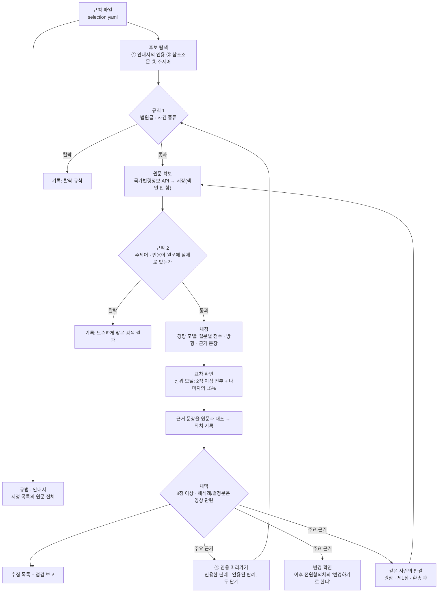

> PrivFrame 2.0 설계 문서의 일부. 전체 목차는 [README.md](./README.md).

## 17. M4-1 법률 코퍼스 수집 기록 (2026-11-13)

팀이 정한 선정 기준 D1~D13([13](./13-corpus-selection-definitions.md))으로 법률 코퍼스를 실제로 선정하고 수집한 기록이다. 무엇을 했는지뿐 아니라 어떻게 접근했고, 무엇을 측정했으며, 무엇이 문제였고 어떻게 풀었는지를 남긴다.

### 17.1 한눈에

| | |
|---|---|
| 한 일 | 규범 7종 · 안내서 2종을 확보하고, 사례 후보 2,110건을 찾아 원문 1,642건을 받고, LLM이 1,386건을 읽어 **주요 근거 232건**을 채택했다. 채택한 대법원 판례 47건의 원심 · 제1심 37건을 경과 확인용으로 더 받았다 |
| 결과물 | 수집 목록 [`configs/corpus/lists/v1-20261113-dff1d3fa.yaml`](../../configs/corpus/lists/v1-20261113-dff1d3fa.yaml) (문서 278건 + 확보하지 못한 것 42건) |
| 기준 | 팀 문서 D1~D13, 7절의 결정 사항은 제안(A)대로. 규칙은 [`configs/corpus/selection.yaml`](../../configs/corpus/selection.yaml) |
| 채점 | 경량 모델(Claude Haiku 5.5)이 전부, 상위 모델(Claude Sonnet 5.5)이 513건을 다시 읽음. 채택 판정 일치 461건(89.9%) |
| 비용 · 시간 | 모델 비용 $18.35(Haiku 1,907회 $2.77 · Sonnet 583회 $15.57). 국가법령정보 API 호출은 무료. 깨어 있던 시간 기준 약 50분. 처음에는 $17.94로 적었다가 바로잡았다(17.11의 15) |
| 색인 | 하지 않았다. 수집한 원문은 모두 `index: false`이고, 서비스가 쓰는 색인(소량 목록 10건)은 그대로다 |
| 확인하지 못한 것 | 파기환송 · 일부 파기된 22건의 환송 후 판결(0건 확보), 현행 조문과의 대응. 안내서 · 사례집 · 판례집 5종은 같은 날 밤에 받아 두었으나 국가법령정보의 점검으로 목록에는 아직 넣지 못했다([17.17](#1717-안내서-5종-반영과-점검으로-멈춘-실행-2026-11-13-밤)) |

### 17.2 문제

M4까지 서비스는 12건짜리 소량 목록으로 동작했다. 그 상태에서 두 가지가 드러났다(팀 회의 2026-11-12).

1. **코퍼스에 무엇이 들어야 하는지 기준이 없다.** 법령은 어디까지인지, 판례는 무엇을 어떤 기준으로 넣는지.
2. **같은 사건의 판결이 일부만 있으면 결론을 모른 채 인용한다.** 대법원이 파기환송한 사건의 하급심만 검색되거나, 판결문의 한 쪽만 떨어져 나와 결론과 반대 방향의 근거로 쓰인다. 실제로 세 번의 실험 모두에서 분석 에이전트가 "명찰을 가려라"의 근거로 대법원 2020다253423의 5쪽을 붙였는데, 그 판결은 방송사에 유리한 취지로 파기환송한 것이었다.

팀은 첫째 문제의 기준을 D1~D13으로 정했고, 둘째 문제 가운데 "수집 단계에서 확보해 둘 것"(같은 사건의 관련 판결, D11)을 그 안에 넣었다. 청킹 · 검색 · 인용 검증은 수집 뒤로 미뤘다. M4-1은 그 기준대로 실제로 모으는 일이다.

전제는 두 가지다(2026-11-11 결정): **원문만 쓴다**(요약 카드를 만들지 않는다), **사람이 고르거나 검토하지 않는다**(규칙과 모델이 고르고 근거를 남긴다).

### 17.3 접근

기준 문서를 그대로 실행 가능한 형태로 옮기는 데 세 가지를 정했다([ADR-0015](../adr/0015-corpus-selection-is-a-recorded-run-apart-from-indexing.md)).

- **선정은 규칙 파일 하나로 도는 실행이다.** 범위 질문, 지정 목록, 탐색 낱말, 거르는 규칙, 점수의 뜻과 기준, 채점 모델이 모두 규칙 파일에 있고, 그 해시가 목록의 버전에 들어간다. 사람이 바꾸는 것은 문서 목록이 아니라 규칙이다.
- **모든 단계가 기록을 남긴다.** 검색마다 조건 · 건수 · 시각, 후보마다 통과한 규칙 · 모델 · 점수 · 근거 문장 · 탈락 이유. 확인하지 못한 것은 "미확인"으로 남기고 "없음"으로 적지 않는다.
- **모은 원문은 색인하지 않는다.** 무엇을 색인하고 판결문을 어떻게 나눌지는 다음 결정이므로, 수집이 서비스의 검색 결과를 바꾸지 않게 했다.



구현은 `backend/src/privframe/core/selection.py`(단계와 기록), `core/casetext.py`(판결문이 스스로 적어 둔 것 읽기: 사건번호, 원심 표시, 주문, 인용), `harness/corpus.py`의 `select` 명령이다. 테스트(`backend/tests/test_core_selection.py`, 10개)는 대본대로 답하는 가짜 API와 가짜 채점기로 전체 흐름을 돌린다.

### 17.4 사전 측정: 만들기 전에 확인한 것

규칙을 쓰기 전에 국가법령정보 API를 직접 불러 네 가지를 쟀다. 이 측정이 설계를 여러 곳에서 바꿨다.

**① 경로별 후보 규모** (2026-11-13, `lawSearch`의 `totalCnt`)

| 경로 | 조건 | 전체 | 대법원만 |
|---|---|---|---|
| ② 참조조문 | 개인정보 보호법 | 68 | 49 |
| ② 참조조문 | 공공기관의 개인정보보호에 관한 법률(구법) | 18 | 9 |
| ③ 주제어 | 초상권 | 86 | 21 |
| ③ 주제어 | 개인영상정보 | 504 | 63 |
| ③ 주제어 | 영상정보처리기기 | 95 | 17 |
| ③ 주제어 | CCTV 열람 | 37 | 6 |
| ③ 주제어 | 촬영 동의 | 610 | 64 |
| ③ 주제어 | 블랙박스 | 109 | 8 |
| ③ 주제어 | CCTV | 700 | 90 |
| ③ 주제어 | 위치정보 | 1,341 | 205 |

**② 본문 검색은 낱말을 느슨하게 맞춘다.** "개인영상정보"로 찾은 대법원 판결 8건을 받아 보니 8건 모두 그 낱말이 원문에 없었다(상관모욕, 차별구제청구 등). 검색어를 형태소로 나눠 맞추는 것으로 보인다. → 검색 결과를 그대로 믿지 않고, **받은 원문에 낱말이 실제로 있는지 다시 확인하는 규칙**을 넣었다.

**③ API의 판결 전문은 대법원 판결문 PDF와 같다.** 같은 판결 3건(2020다253423 · 2020다227455 · 2021다219116)을 양쪽에서 받아 공백을 빼고 비교했다: API 2,722자 대 PDF 2,770자 등으로, 차이는 PDF의 머리글 · 쪽 번호뿐이었다. → 판례는 API 원문으로 충분하고, PDF는 같은 문서의 다른 출처로 기록만 한다.

**④ 응답의 생김새.** 판례 본문에는 `【원심판결】 서울서부지법 2020. 7. 16. 선고 2019나38288 판결`처럼 원심이 적혀 있고 `【주문】`이 따로 있다. → 같은 사건의 판결(D11)을 유사도가 아니라 **원문에 적힌 표시**로 찾을 수 있다. 사건번호로 본문을 검색하면 그 판결을 인용한 판결이 나온다(2004다16280 → 19건). → ④의 "그 판례를 인용한 이후 판례"를 찾을 길이 있다.

측정 중에 하나 더 발견했다: **검색 결과의 상세 주소에 호출자의 인증값(OC)이 들어 있다.** 검색 기록을 그대로 저장하면 인증값이 파일에 남는다. → 수집기와 선정 기록이 저장 전에 그 값을 지운다(확인: 저장된 파일 1,995개에서 0건).

### 17.5 단계별 결과

| 단계 (D7) | 건수 | 내역 |
|---|---|---|
| 검색 | 448회 | 규범 7 · ② 4 · ③ 47 · ① 14 · ④ 314 · 경과 62 (`searches.jsonl`) |
| 후보 | 2,110 | 판례 1,201 · 헌재 589 · 결정문 255 · 해석례 65. 두 경로 이상으로 찾은 것 141 |
| 규칙 1 탈락 | 510 | v1의 주요 채택 대상이 아닌 법원(하급심 등) 485 · 특허 14 · 세무 11 |
| 원문 확보 | 1,642 | 판례 744 · 헌재 578 · 결정문 255 · 해석례 65. 전체 원문 1,620 · 일부만 22 |
| 원문 미확보 | 117 | API에 사건번호가 없음 100 · 목록에는 있고 본문은 주지 않음 17 |
| 중복 | 39 | 같은 문서가 다른 일련번호로 한 번 더 실림 (결정문 29 · 해석례 10) |
| 규칙 2 탈락 | 143 | 주제어도 인용도 원문에 없음 (느슨하게 맞은 검색 결과) |
| 채점 | 1,386 | 판례 530 · 헌재 575 · 결정문 226 · 해석례 55 |
| **주요 근거 채택** | **232** | 판례 47 · 헌재 19 · 해석례 3 · 결정문 163 |
| 경과 확인용 확보 | 37 | 채택 판례의 원심 29 · 제1심 8 |

경로별 후보 수(한 후보가 여러 경로에 들 수 있다): ① 19 · ② 53 · ③ 1,324 · ④ 724 · 경과 128 · 변경 확인 10.

채택되지 않은 1,878건의 이유:

| 이유 | 건수 |
|---|---|
| 범위 밖 (모델 판정: 대부분 "무관", 그 밖에 저작권 · 음성 녹음 · 안전조치 · 과징금 산정 등) | 1,032 |
| 규칙: v1의 주요 채택 대상이 아닌 법원 | 417 |
| 규칙: 주제어가 원문에 없음 | 143 |
| 원문 미확보: API에 없음 | 100 |
| 점수 미달 (최고 2점 55 · 1점 19 · 0점 24) | 98 |
| 중복 | 39 |
| 해석례 · 결정문인데 영상 관련이 아님 | 21 |
| 규칙: 사건 종류 특허 · 세무 | 25 |
| 보류 (D3) | 3 |

**④ 인용 따라가기.** 첫 탐색에서 223건이 채택되었고, 그것들을 따라가 5건, 그 5건을 따라가 4건이 더 채택되었다. 두 단계에서 멈췄다(문서의 상한). 인용 경로로만 찾은 채택은 8건이다(예: 2011다53164, 2014다77970, 2008도7007).

- 채택 문서가 본문에서 인용한 사건: 265건.
- 사건번호 검색으로 찾은 "인용한 판결" 후보: 472건. 이 가운데 원문에 그 사건번호가 실제로 있던 것 59건, 없던 것 27건, 하급심이라 v1에서 읽지 않은 것 386건.
- 검색이 너무 넓어 쓰지 않은 것 1건: "2007다71"은 1,855건이 나왔다(번호가 짧아 무관한 판결까지 맞춤).

### 17.6 채점

**무엇을 묻는가.** 모델은 원문 전체를 읽고 (1) 범위 안 · 밖 · 보류, (2) Q0~Q8 가운데 닿는 질문마다 점수(3 · 2 · 1), 방향, **근거 문장 하나를 원문 그대로**, 한 문장의 이유, (3) 영상 관련 여부를 낸다. 요약은 쓰지 않는다. 지시문은 규칙 파일의 범위 기준 · 질문 · 범위 밖/보류 목록 · 점수의 뜻에서 만들어지고(`Rules.instructions`), 그 해시(`67e0a298dc65`)가 기록에 남는다.

| 점수 | 뜻 |
|---|---|
| 3 | 이 글의 판단(조문이면 규정 내용)을 알면 가림 결정이나 그 근거 설명이 달라질 수 있다. 그 질문의 판단 기준이나 결론을 직접 밝혔다 |
| 2 | 같은 쟁점을 다루지만 가림 결정에 쓰려면 유추가 필요하다 |
| 1 | 관련 낱말이나 조문이 나오지만 그 쟁점에 대한 판단은 없다 (영상이 증거로만 나오는 경우 등) |

**경량 모델의 점수 분포** (문서의 최고 점수)

| 종류 | 범위 밖 | 0~1 | 2 | 3 | 보류 |
|---|---|---|---|---|---|
| 판례 530 | 402 | 14 | 61 | 52 | 1 |
| 헌재 575 | 494 | 30 | 24 | 26 | 1 |
| 해석례 55 | 48 | — | 1 | 6 | — |
| 결정문 226 | 36 | 1 | 23 | 166 | — |

주제어로 찾은 판례와 헌재 결정의 4분의 3 이상이 범위 밖이었다. CCTV가 증거로만 나오는 형사 판결, 촬영이 낱말로만 나오는 헌재 결정이 대부분이다. 규칙만으로는 거를 수 없고 원문을 읽어야 갈리는 부분이다.

**교차 확인.** 상위 모델이 다시 읽은 것은 513건이다: 경량 모델이 2점 이상을 준 361건 전부와, 나머지 가운데 무작위 152건(15%, 고정 시드).

| 경량 → 상위 (최고 점수) | 건수 |
|---|---|
| 3 → 3 | 216 |
| 3 → 2 | 24 |
| 3 → 0~1 | 10 |
| 2 → 3 | 23 |
| 2 → 2 | 41 |
| 2 → 0 | 45 |
| 0~1 → 0 | 150 |
| 0 → 2 | 4 |

- 채택 판정이 같은 것은 461건(89.9%)이다. 갈린 52건은 상위 모델의 판정을 썼다.
- 상위 모델이 더 엄격했다: 경량 모델이 범위 안이라고 본 것 가운데 55건을 범위 밖으로 봤다.
- **놓친 것의 표본 검사:** 경량 모델이 탈락시킨 것 가운데 무작위 152건에서 상위 모델이 채택으로 뒤집은 것은 0건이었다(2점으로 올린 것 4건). 규칙의 상향 기준(10% 초과 시 전부 상위 모델로)에 걸리지 않았다. 152건 중 0건이므로 놓친 비율의 95% 상한은 약 2%다.

**근거 문장의 원문 대조.** 채택의 근거가 된 문장(3점짜리) 476개 가운데 468개(98.3%)가 원문에 그대로 있었고 위치(단위 · 글자 위치)를 기록했다. 8개는 모델이 말줄임표를 넣거나 표현을 바꿔 대조되지 않았고 "근거 문장의 위치 미확인"으로 남겼다.

**실제 기록 한 건: 대법원 2020다253423** (오용되었던 그 판결)

| 질문 | 점수 | 방향 | 근거 문장 (원문 위치) |
|---|---|---|---|
| Q1 | 3 | 찍힌 사람 쪽 | "사람은 누구나 자신의 얼굴 그 밖에 사회통념상 특정인임을 식별할 수 있는 신체적 특징에 관해 함부로 촬영되거나 … 영리적으로 이용되지 않을 권리를 갖는다." (판례내용 1087) |
| Q3 | 3 | 찍거나 공개한 쪽 | "그러므로 이 사건 방송 내용은 공공성·사회성이 있어 공적 관심사에 해당하는 것이라고 할 수 있다." (2567) |
| Q6 | 3 | 찍거나 공개한 쪽 | "이러한 사정들을 종합하면 이 사건 방송을 통한 피고들의 표현의 자유가 초상권 침해로 원고가 입을 피해보다 결코 가볍다고 볼 수 없다." (3184) |
| Q7 | 2 | 찍거나 공개한 쪽 | "설사 이 사건 방송에서 원고의 얼굴을 식별할 수 없게 하였더라도 시청자들은 그 등장인물이 원고라는 사실을 충분히 알 수 있었다." (2926) |

- 예전에 "명찰도 가려야 한다"의 근거로 잘못 쓰인 문장이 Q7의 근거 문장이다. 선정 기록은 그 문장의 방향을 "찍거나 공개한 쪽"으로, 점수를 2(유추 필요)로 적었다. 두 모델이 같았다.
- 같은 판결의 기록: 원심은 서울서부지법 2019나38288(원문 미확보), 주문은 "원심판결 중 피고들 패소 부분을 파기하고 … 환송한다"(일부 파기), 환송 후 판결은 찾지 못함, 변경 문구는 발견 못 함(이 사건번호를 언급한 판결 0건).

### 17.7 질문별 결과

| 질문 | 채점된 후보 | 채택: 판례 | 헌재 | 해석례 | 결정문 | 3점 조문 | 방향 (찍힌 사람 쪽 / 반대쪽 / 갈림) |
|---|---|---|---|---|---|---|---|
| Q0 법 체계 | 199 | 3 | 3 | — | 21 | 3 | 11 / 10 / 1 |
| Q1 개인정보인가 | 160 | 15 | 6 | — | 22 | 3 | 40 / 2 / 0 |
| Q2 촬영 · 수집 | 154 | 13 | 10 | — | 61 | 7 | 49 / 28 / 6 |
| Q3 공개 · 제공 | 214 | 26 | 5 | 3 | 101 | 4 | 54 / 63 / 18 |
| Q4 동의의 범위 | 69 | 12 | 1 | — | 11 | 7 | 20 / 4 / 0 |
| Q5 더 보호되는 대상 | 74 | 6 | 7 | — | 12 | 5 | 21 / 0 / 4 |
| Q6 예외와 이익형량 | 169 | 24 | 6 | 1 | 65 | 5 | 20 / 61 / 15 |
| Q7 가림 수준 | 59 | 6 | 2 | — | 15 | 2 | 19 / 3 / 1 |
| Q8 정보주체의 요청 | 31 | — | 1 | — | 18 | 6 | 15 / 2 / 2 |

- 모든 질문에 채택 자료가 있다. 안내서 2종은 아홉 질문 모두에 2점 이상으로 닿는다.
- 모든 질문에 양쪽 방향의 사례가 있어 "주제어를 넓혀 다시 찾기"는 실제 실행에서 한 번도 걸리지 않았다(가짜 API 테스트로만 확인). 다만 **Q5는 순수하게 반대쪽인 사례가 0건**(갈림 4건)이고, **Q8은 판례가 0건**이다(헌재 1 · 결정문 18).
- 채택 판례 47건은 형사 26 · 민사 21이고 선고 시기는 1997~2026년이다. 형사가 절반을 넘는다(카메라등이용촬영, 개인정보 보호법 위반 가운데 CCTV 영상 사건). 사건 종류 규칙에서 형사를 뺐다면 절반을 잃었다.
- 채택의 70%(163건)가 개인정보위 결정문이다. 대부분 "○○시 통합관제센터 영상정보의 △△ 제공 관련 질의", "개인영상정보 열람요구 거절", "웨어러블 카메라 · 드론" 같은 법령해석 의결이어서, 영상의 제공 · 이용(Q3 · Q6 · Q2)에 직접 닿는다.

### 17.8 규범: 조문 채점과 문서 예시의 대조

규범 7종의 원문 전체를 받았고(수집 기준일의 현행본), 조문 341개를 채점했다.

| 규범 | 시행일 | 조문 | 채점 | 3점 조문 |
|---|---|---|---|---|
| 개인정보 보호법 | 2026-09-11 | 127 | 전부 | 13 (제2 · 3 · 17 · 18 · 19 · 22의2 · 23 · 25 · 25의2 · 28의7 · 35 · 58 · 58의2조) |
| 같은 법 시행령 | 2026-11-10 | 142 | 전부 | 4 (제22 · 27 · 27의2 · 42조) |
| 표준 개인정보 보호지침 | 2025-04-11 | 64 | 전부 | 8 (제2 · 4 · 12 · 35 · 39의2 · 40 · 44 · 46조) |
| 대한민국헌법 | 1988-02-25 | 130 | 제10 · 17 · 21조 | — |
| 민법 | 2026-03-17 | 1,193 | 제750 · 751조 | — |
| 언론중재법 | 2023-08-08 | 37 | 제5조 | 1 |
| 위치정보법 (보완 제안) | 2025-10-01 | 53 | 제2 · 15조 | — |

**문서(D2)가 예로 든 조문 18개 가운데 16개가 같은 질문에 2점 이상이었다**(3점 12개, 2점 4개). 어긋난 2개가 헌법 제21조와 민법 제750조다.

**발견 1. 연결 조문은 조문만 읽어서는 관련이 드러나지 않는다.** 헌법 제10조와 민법 제750 · 751조는 두 모델 모두 "무관"으로 판정했다. 헌법 제17 · 21조도 상위 모델이 1~2점을 줬을 뿐이다. 추상적인 조문은 스스로 가림 기준을 정하지 않기 때문이다. 그런데 **채택된 판례가 참조조문으로 가장 많이 든 것이 바로 이 조문들이다**:

| 채택 판례의 참조조문 | 인용한 채택 판례 수 | 수집 상태 |
|---|---|---|
| 헌법 제10조 | 23 | 채택 (①-A) |
| 민법 제750조 | 17 | 채택 (①-A) |
| 헌법 제17조 | 15 | 채택 (①-A) |
| 헌법 제21조 | 12 | 채택 (①-A) |
| 민법 제751조 | 11 | 채택 (①-A) |
| 헌법 제37조 | 9 | 법령은 수집, 조문은 목록에 없음 |
| 성폭력범죄의 처벌 등에 관한 특례법 제14조 | 6 | 법령 미수집 |
| 형법 제20조 (정당행위) | 5 | 법령 미수집 |
| 형사소송법 제307 · 308조 | 각 3 | 법령 미수집 |

→ 7절 ①의 제안(A: 연결 조문을 넣는다)은 판례의 인용으로 뒷받침된다. 동시에 **목록에 없던 조문**이 드러났다: 헌법 제37조(기본권 제한의 한계), 형법 제20조(위법성 조각의 일반 조항), 성폭력처벌법 제14조(촬영물). 다음 버전의 추가 수집 후보로 남긴다(D3의 절차).

**발견 2. 문서의 예시에서 빠진 조문.** D2는 Q2의 규범으로 "시행령 제22~27조"를 들었는데, 이동형 기기의 촬영 사실 표시를 정한 **시행령 제27조의2**가 Q2에 3점으로 나왔다. D2의 Q8 "표준지침 영상 조항"은 구체적으로 **제44조(열람 등 요구)와 제46조(정보주체 이외의 자의 개인영상정보 보호)**였다. 제46조가 "열람 때 다른 사람 부분을 가리는 일"을 직접 정한다.

**발견 3. 위치정보법은 직접 근거가 아니다.** 시스템이 위치 태그의 유지 · 삭제를 정하는데도 근거 문서가 없어 보완 제안으로 제2 · 15조를 받았다. 경량 모델은 "무관", 상위 모델은 Q1에 2점(유추 필요)을 줬다. 영상 파일의 촬영 위치를 직접 다루는 조문이 아니라는 뜻이다. 원문은 확보해 두었고, 채택할지는 팀이 정한다.

**발견 4. 문서가 예로 든 판례 4건은 모두 예시와 같은 질문에 3점으로 채택되었다.** 다만 헌재 2015헌마994(어린이집 CCTV 설치 의무와 보호자의 열람)는 Q8에서 "열람을 허용하는 쪽"의 결정이고, 문서의 설명("열람 요청 때 타인 가림")을 직접 다룬 것은 아니다. Q1 · Q2 · Q3 · Q5 · Q6에도 3점이다.

### 17.9 변경 확인과 같은 사건의 판결

**변경 여부(D10 3단계).** 채택한 대법원 판례 47건마다 그 사건번호를 언급한 이후 전원합의체 판결을 찾아 "변경" 문구를 대조했다.

| 결과 | 건수 |
|---|---|
| 변경 문구 발견 | 0 |
| 발견 못 함 (확인한 범위와 시각을 기록) | 46 |
| 검사 못 함 (2007다71: 사건번호 검색이 1,855건으로 넓어 쓰지 못함) | 1 |
| 검사 안 함 (헌재 결정 · 해석례 · 결정문: 전원합의체의 판례 변경 대상이 아님) | 185 |

"발견 못 함"은 변경이 없다는 확인이 아니다. 국가법령정보 API의 본문 검색에서 확인한 범위 안의 결과다.

**같은 사건의 판결(D11).** 채택한 대법원 판례 47건의 원문에 적힌 원심 표시로 찾았다.

| 확인한 것 | 결과 |
|---|---|
| 원심 표시 | 45건에 있음, 2건은 원문에 표시 없음(미확인) |
| 원심의 원문 | 확보 29 · 미확보 16 (API에 그 사건번호가 없음) |
| 제1심의 원문 (확보한 원심 29건에 적힌 것) | 확보 8 · 미확보 21 |
| 원심의 처리 (채택 판결 47건의 주문에서) | 유지 25 · 파기환송 17 · 일부 파기 5 |
| **환송 후 판결** (파기환송 · 일부 파기 22건) | **확보 0 · 미확인 22** |

- **채택한 대법원 판례의 거의 절반(22건)이 원심을 깨고 돌려보낸 판결인데, 그 뒤의 판결은 한 건도 찾지 못했다.** 2020다253423, 2021다219116, 2004다16280이 모두 여기에 든다. 팀 회의에서 걱정한 "최종 결론을 모른 채 진행"이 수치로 확인되었다. 이 판결들을 인용할 때는 "원심을 파기했다"까지만 말할 수 있고 사건이 어떻게 끝났는지는 말할 수 없다.
- 원인은 출처의 수록 범위다. 국가법령정보 API에는 하급심이 일부만 있고, 환송 후 판결은 거의 없다. 미확보 37건은 수집 목록의 `missing`에 사건번호와 함께 적었다. 법원의 판결서 열람으로 사건번호를 넣어 받을 수 있다.
- 확보한 원심 29건 가운데 12건은 **상급심에서 파기된 판결**이다(파기환송 10 · 일부 파기 2). 경과 확인용으로만 받아 두었고 색인하지 않았다. 나중에 색인한다면 "파기됨"을 표시하지 않고 넣어서는 안 된다(주문에서 읽은 처리 결과가 기록에 있다).

### 17.10 수집 목록과 점검 (D12 · D13)

**목록 `v1-20261113-dff1d3fa`.** 버전 ID는 규칙 파일의 해시 + 수집 기준일 + 채택 원문의 해시로 만든다.

| 구분 | 건수 |
|---|---|
| 규범 (법령 6 · 행정규칙 1) | 7 |
| 안내서 | 2 |
| 주요 근거: 판례 47 · 헌재 19 · 해석례 3 · 결정문 163 | 232 |
| 경과 확인용 판결 (원심 · 제1심) | 37 |
| **문서 합계** | **278** |
| 확보하지 못한 것 (`missing`): 안내서 · 사례집 · 판례집 5, 원심 · 제1심 37 | 42 |

목록은 기존 수집 목록과 같은 형식이다. 다른 컴퓨터에서 `privframe-corpus fetch <목록>`으로 같은 원문을 받고(해시로 대조할 수 있다), 새로 받은 문서는 색인되지 않는다(`defaults.index: false`).

**점검 (D13)**

| 점검할 것 | 결과 |
|---|---|
| 범위 | 질문별 후보 · 채택 수를 기록했다(17.7). 자료가 없는 질문은 없다. Q8은 판례가 없다 |
| 원문 | 확보 1,642건 가운데 전체 원문 1,620건. 목록에 든 문서 가운데 일부만 확보한 것은 9건이고 무엇이 빠졌는지 적었다(헌재 1건은 전문 없음, 결정문 1건 · 판례 7건은 이유 없음) |
| 관련 판결 | 원심 · 제1심 · 환송 후 관계 98건을 기록했다. 관계마다 근거와 확보 상태가 있고, 원심 표시 문장 45개는 모두 원문에서 위치를 대조했다(17.9) |
| 출처 · 판본 | 확보한 1,642건 모두 원문 ID · 출처 주소 · 일자 · 받은 시각 · 해시가 있다(빠진 것 0건). 같은 문서를 API와 PDF로 받은 3건은 따로 저장하고 묶어 적었다 |
| 미확인 사항 | 구분해서 남겼다: 원문 미확보 117, 일부만 확보 22, 근거 문장의 위치 미확인 8, 환송 후 판결 미확인 22, 원심 표시 없음 2, 변경 여부 "발견 못 함" 46 · "검사 못 함" 1, 현행 조문과의 대응(전부 미확인) |
| 선정 기록 | 채택 232건 모두에 통과한 규칙 · 모델 · 점수 · 근거 문장이 있다. 탈락 1,878건에도 이유가 있다 |

이 점검은 필요한 자료를 확보했는지를 본 것이다. 검색 성능이나 법률 판단의 정확성을 검증한 것이 아니다.

### 17.11 만난 문제와 해결

| # | 문제 | 어떻게 알았나 | 해결 |
|---|---|---|---|
| 1 | API의 본문 검색이 낱말을 느슨하게 맞춘다 | 사전 측정: "개인영상정보" 8건 모두 그 낱말 없음 | 받은 원문에서 낱말을 다시 확인하는 규칙. 143건이 여기서 걸러졌다 |
| 2 | 사건번호 검색도 느슨하다 | 첫 실행 뒤 기록 검토: ④ 후보가 1,661건으로 불었고 "2007다71" 한 건이 1,855건을 돌려줌. 확인해 보니 받아 온 280건 가운데 163건에 그 사건번호가 없었다 | 원문에 사건번호가 있을 때만 인용으로 친다. 결과가 300건을 넘는 검색은 쓰지 않고 그렇게 기록한다. ④ 후보는 724건이 되었다 |
| 3 | 같은 결정문이 다른 일련번호로 두 번 실려 있고 둘 다 채택됨 | 첫 실행의 "같은 인용 표기를 가진 문서" 목록 | 본문이 같으면 한 번만 읽고 한 번만 채택한다(39건). 채택은 237건에서 232건이 되었다 |
| 4 | 결정문 47건의 목록 정보가 비어 있고 안건번호가 "null" | 채택 목록의 인용 표기가 모두 "개인정보보호위원회 null" | 이름 · 번호 · 날짜를 본문에서 읽고, 번호가 없으면 일련번호로 적는다 |
| 5 | 목록에는 있는데 본문은 "일치하는 판례가 없습니다"인 판결 17건 | 분할 실패 기록 | 원문으로 저장하지 않고 "API가 본문을 주지 않음"으로 남긴다 |
| 6 | 원심을 인용 판례로 따라감 | 가짜 API 테스트에서 원심 조회가 ④로 기록됨 | 원심 · 제1심은 인용 목록에서 빼고 D11로만 찾는다(문서 D9의 구분 그대로) |
| 7 | 검색 결과의 주소에 인증값이 들어 있음 | 사전 측정의 출력 | 저장 전에 지운다. 저장된 파일 전부를 대조해 0건 확인 |
| 8 | 수집 중 컴퓨터가 잠들어 2시간 멈춤(16:00~17:59). 깨어난 직후의 요청 15건이 주소 조회 실패 | 진행이 멈춘 것을 확인 | 잠들지 않게 하고 다시 실행. 원문은 저장소에, 채점은 캐시에 있어 이어서 했다. 실패한 15건은 다음 실행에서 다시 받았다 |
| 9 | 모델 비용을 미리 알리지 않고 시작하려 했음 | 사용자의 확인 | 채점 전에 멈추고 예상 비용과 선택지를 알린 뒤 진행. 비용 상한은 규칙이 아니라 실행 옵션으로 옮겼다(올려도 같은 실행이 이어진다) |
| 10 | 예상($12~15)보다 비용이 더 들었다($18.35) | 채점 기록의 합계 | 교차 확인 대상(2점 이상)이 예상보다 많았다(361건). 기록에 실제 값을 적었다 |
| 11 | 판례집 PDF(75쪽, 83.6MB)에 글자 층이 없다. 글자가 도형으로 바뀌어 있어 추출되는 글자가 0자 | 받아 둔 파일을 실행 전에 열어 봄 | 글자 층이 없으면 쪽을 그림으로 바꿔 OCR로 읽는다(`pdf_ocr`). 그렇게 읽은 문서는 등록부와 단위마다 OCR로 읽었다고 적는다 |
| 12 | OCR이 줄의 3분의 1을 버렸다 | 읽은 쪽을 원본과 눈으로 대조: 문장이 한 줄씩 건너뜀 | 줄이 뒤집혔는지 보는 단계가 촘촘한 본문의 멀쩡한 줄을 뒤집어 읽고 있었다. 그려 낸 쪽은 바로 서 있으므로 그 단계를 끄고, 여백에 세로로 인쇄된 장 표시는 뺐다. 5만 748자 → 7만 4,142자, 인용 57건 → 59건 |
| 13 | **국가법령정보가 점검으로 멈췄는데(11-13 21:00 ~ 11-14 21:00) 실행은 끝까지 가서 빈 목록을 냈다.** 검색 143회가 모두 실패했는데 "0건"으로 처리되어, 안내서가 인용한 81건이 모두 "API에 없음"으로 적히고 규범 0 · 사례 0인 목록이 만들어졌다 | 실행 결과의 건수(후보 81, 원문 0)가 이상해 검색 기록을 확인: 전부 `302 → /sorry/sorry.html` | 응답이 없는 것과 결과가 없는 것을 나눴다. API가 응답하지 않거나 검색이 실패하면 **실행을 멈추고**(종료 코드 75) 목록을 만들지 않는다. 같은 명령으로 이어서 한다. 잘못 만들어진 목록은 지웠고 그 실행의 기록은 `halted/`로 옮겼다. 테스트: 실행 중 다섯 지점에서 API를 끊고, 이어서 한 결과가 끊기지 않은 실행과 같은지 본다 |
| 14 | 실패한 검색의 오류 문구에 인증값이 들어 있었다(HTTP 라이브러리의 오류 문구가 요청 주소를 그대로 인용). 검색 기록 파일에 286번 저장됨 | 13번을 조사하다가 저장된 파일을 다시 대조 | 파일에서 지웠다(git에 올리지 않는 `data/` 안이고, 화면에는 출력되지 않았다). 클라이언트가 내는 오류는 요청 주소를 인증값 없이 적고, 선정 기록은 쓰기 직전에 한 번 더 지운다. 대조: 선정 기록 · 설정 · 문서 · 코드 · 실행 로그에서 0건 |
| 15 | **비용을 $0.41 적게 보고했다**($17.94로 적었으나 실제는 $18.35). 첫 실행에서 두 번 실린 결정문(문제 3)이 동시에 채점되어 같은 글에 모델을 두 번 부른 것이 33회(Haiku 18 · Sonnet 15) 있었는데, 보고가 같은 글의 채점을 한 번으로 셌다. 재실행의 추가 비용도 $0.68이 아니라 $1.09였다 | 받아 둔 안내서를 점검하다가 채점 기록 파일의 합계(2,495행 $18.40)와 보고의 합계($17.99)가 다른 것을 봄 | 보고가 돈을 낸 호출을 모두 센다. 이 문서의 비용을 실제 값으로 고쳤다. 지금은 같은 글을 채점 전에 걸러 내므로(문제 3의 해결) 중복 호출은 다시 생기지 않는다 |

13번은 설계의 원칙("확인하지 못한 것은 '없음'으로 적지 않는다")을 코드가 한 곳에서 어기고 있던 것이다. 앞선 두 번의 실행에서는 검색 849회가 한 번도 실패하지 않아 드러나지 않았다.

2 · 3 · 4 · 5번은 **첫 실행의 결과를 검토하다가** 찾았다. 그래서 실행을 두 번 했다: 첫 실행(18:36 완료, 채택 237건)과, 고친 뒤의 재실행(19:02 완료, 채택 232건). 같은 원문 · 같은 지시 · 같은 모델의 채점은 다시 쓰이므로 재실행의 추가 비용은 $1.09였다(첫 실행까지 $17.26).

### 17.12 작업 기록 (시간순, 2026-11-13)

| 시각 | 한 일 |
|---|---|
| 15:00 | 팀 노션 문서(선정 기준, 회의록, 용어 정리)를 읽고 기준의 빈 곳과 어긋나는 곳을 정리 |
| 15:10~15:35 | API 사전 측정 4회(17.4) |
| 15:40~15:44 | 규범 7종 수집, 조문 341개와 안내서 2종 채점 (4분 18초, $0.21) |
| 15:47 | 후보 탐색과 원문 수집 시작 (검색 72회, 후보 1,381건) |
| 16:00~17:59 | 컴퓨터 잠자기로 멈춤 |
| 18:05 | 비용 확인을 위해 채점 전에 멈춤 (원문 1,318건 확보) |
| 18:10 | "계획대로 전부"로 결정, 채점 시작 |
| 18:17 | 비용 상한을 올리려고 멈춤 (채점 1,129건은 캐시에 남음) → 18:20 다시 시작 |
| 18:36 | 첫 전체 실행 완료: 후보 3,043 · 원문 1,726 · 채점 1,527 · 채택 237 |
| 18:40~18:55 | 기록 검토에서 문제 2~5번 발견, 수정, 테스트 5개 → 7개 |
| 18:57~19:03 | 재실행(캐시 사용, 6분): 후보 2,110 · 원문 1,642 · 채점 1,386 · 채택 232. 목록 `v1-20261113-dff1d3fa` |
| 19:10~22:30 | 사람이 받아 둘 문서의 받는 곳 · 파일 이름 · 둘 자리를 정리(17.16). 받아 둔 판결문을 가져가는 경로를 구현 |
| 22:34 | 사용자가 개인정보위 문서 5종을 `data/corpus/inbox/`에 둠 |
| 22:40 | 판례집에 글자 층이 없음을 확인, OCR 경로 추가 (문제 11) |
| 22:47~23:10 | 실행: 안내서 5종 저장 · 판례집 OCR · 채점($0.05)까지는 되었으나 검색이 모두 실패. 빈 목록이 만들어짐 (문제 13) |
| 23:11 | 원인 확인: 국가법령정보 시스템 점검(11-13 21:00 ~ 11-14 21:00) |
| 23:15~23:50 | 멈추는 동작과 인증값 문제 수정(문제 13 · 14), OCR 보정(문제 12), 비용 보고 정정(문제 15), 테스트 326개 통과. 안내서 5종의 반영(저장 · 분할 · 채점)까지 하고 마침. 나머지 실행은 점검이 끝난 뒤 사용자가 다시 요청하기로 함 |

### 17.13 한계

- **채택의 품질은 모델에 달려 있다.** 사람이 검토하지 않았다. 안전장치는 두 모델의 교차 확인(일치 89.9%), 놓친 것의 표본 검사(152건 중 0건), 근거 문장의 원문 대조(98.3%)다. 두 모델이 같은 회사의 모델이어서 같은 방향으로 틀릴 수 있다.
- **목록 v1(`dff1d3fa`)에는 안내서 · 사례집 · 판례집 5종이 없다.** 개인정보위 게시판이 자동 요청을 막아 받지 못한 채 만든 목록이다. 경로 ①(기관이 고른 목록)도 안내서 2종의 인용 19건에서만 출발했다. 5종은 그날 밤 사람이 받아 두었고(17.17), 다음 실행의 목록부터 들어간다.
- **판례집은 OCR로 읽은 것이다.** 원문의 글자가 아니라 쪽을 읽어 낸 결과여서 오독이 있을 수 있다(쪽별 인식 점수 평균 0.95, 가장 낮은 쪽 0.66). 인용한 사건번호를 찾는 데 썼고, 찾은 사건은 API의 원문으로 받는다. 판례집 자체를 색인한다면 이 점을 따로 정해야 한다.
- **출처의 수록 범위.** 국가법령정보 API에 없는 판결(하급심 대부분, 환송 후 판결)은 찾을 수 없었다. "찾지 못함"이 "없음"은 아니다.
- **현행 조문과의 대응을 확인하지 않았다.** 판례의 참조조문은 원문 그대로 두었고, 같은 번호의 조문이 현행본에 있는지만 봤다. 구법 표기(예: "구 개인정보 보호법(2023. 3. 14. 개정 전) 제71조")는 대응 미확인으로 남겼다.
- **v2(하급심 포함)는 실행하지 않았다.** 7절 ②의 제안대로 v1만 했다. 하급심 후보는 목록 단계에서 417건이 기록되어 있고, 규칙의 `versions.v2`로 같은 명령을 돌리면 된다.
- 헌재 결정을 인용한 이후 결정은 따라가지 않았다(판례의 사건번호 검색만 했다).
- 보류 목록의 경계가 모호한 사례가 있었다: 2006다65620(범죄 혐의자의 신원을 밝힌 보도)을 모델이 "범죄 피해자 · 소년의 신원 보도 금지"로 보류했다. 문구대로라면 혐의자는 보류 대상이 아니다.

### 17.14 팀이 정할 것

1. **7절 ①~④.** 제안(A)대로 실행했다. 그대로 확정할지.
2. **보완 제안의 채택 여부**: Q1에 "파일에 기록된 정보(촬영 위치)"를 넣은 것, 위치정보법 제2 · 15조(상위 모델 2점).
3. **추가 수집 후보**: 헌법 제37조, 형법 제20조, 성폭력처벌법 제14조(17.8의 표).
4. ~~안내서 · 사례집 · 판례집 5종을 받아 둘지~~ → 2026-11-13 밤에 받아 두었다(17.17). 남은 것: OCR로 읽은 판례집을 원문으로 볼지, 인용을 찾는 용도로만 둘지.
5. **환송 후 판결 22건과 미확보 원심 · 제1심 37건**을 법원 판결서 열람으로 받을지.
6. **보류 목록의 문구**: 범죄 혐의자의 신원 보도를 보류에 넣을지 Q6로 볼지.
7. 다음 단계("법률 코퍼스 구조"): 무엇을 색인할지(주요 근거만인지, 경과 확인용은 어떻게 표시할지), 판결문을 어떻게 나눌지, 인용 검증. 이 수집 결과가 그 논의의 입력이다. 선정 기록의 방향 · 주문 처리 결과를 그때 쓸지도 정할 일이다(지금은 원문 곁의 기록으로만 있다).

### 17.15 다시 하는 법과 기록의 위치

```bash
uv run privframe-corpus select configs/corpus/selection.yaml --version v1        # 전체 (모델 비용이 든다. 같은 원문의 채점은 다시 쓰인다)
uv run privframe-corpus select configs/corpus/selection.yaml --until process     # 중간 단계까지만
uv run privframe-corpus select configs/corpus/selection.yaml --cost-cap 30       # 비용 상한을 바꿔 이어서
# 국가법령정보 API가 응답하지 않으면 "멈춤"을 알리고 종료 코드 75로 끝난다. 목록은 만들지 않는다. 같은 명령으로 이어서 한다.
uv run privframe-corpus fetch configs/corpus/lists/v1-20261113-dff1d3fa.yaml     # 다른 컴퓨터에서 같은 원문 받기 (LAW_OC 필요)
uv run --group models pytest backend/tests/test_core_selection.py                # 가짜 API로 전체 흐름 (키 불필요)
```

| 위치 | 내용 | git |
|---|---|---|
| `configs/corpus/selection.yaml` | 선정 규칙 | ○ |
| `configs/corpus/lists/v1-20261113-dff1d3fa.yaml` | 수집 목록: 문서 278건의 출처 · 해시 · 채택 목적 · 질문별 점수, 미확보 42건 | ○ |
| `data/corpus/raw/` · `registry.jsonl` · `docs/` | 원문 1,754건(소량 목록 12건 포함), 등록부, 단위로 나눈 문서 | × |
| `data/corpus/selection/v1-a7f5bee4/state.json` | 후보 2,110건의 선정 기록 전부, 관계 98건, 조문 채점 | × |
| `data/corpus/selection/v1-a7f5bee4/searches.jsonl` | 검색 448회의 조건 · 건수 · 시각 | × |
| `data/corpus/selection/v1-a7f5bee4/report.json` | 점검 보고(이 문서의 수치) | × |
| `data/corpus/selection/grades.jsonl` | 모델 호출의 결과와 비용 (재실행까지 2,490회 $18.35, 11-13 밤의 안내서 5종 채점 뒤 2,495회 $18.40) | × |
| `data/corpus/selection/v1-a7f20322/` | 고치기 전 첫 실행의 기록 | × |
| `data/corpus/selection/halted/v1-39ee0af4-api-maintenance-20261113/` | 점검 중에 돌아 잘못 끝난 실행의 기록(문제 13). 실패한 검색 143회 | × |

`data/`는 git에 올리지 않는다. 이 문서의 수치는 위 기록에서 옮긴 것이고, 목록 파일만 있으면 원문은 다시 받을 수 있다.

### 17.16 사람이 받아 둘 문서 (2026-11-13 기준)

API로 받을 수 없는 문서는 사람이 받아 정해진 자리에 두면, 같은 명령(`privframe-corpus select …`)이 다음 실행에서 가져간다.

**① 개인정보위 문서 5종 (무료). → 2026-11-13 22:34에 받아 두었다(17.17).** 받는 곳은 브라우저로 열어 게시글 제목을 확인했다. 게시글의 첨부 PDF를 받아 아래 이름으로 `data/corpus/inbox/`에 둔다.

| 문서 | 받는 곳 | 저장할 이름 |
|---|---|---|
| 가명정보 처리 가이드라인 (2026.3. 개정) | [안내서 게시판 11931](https://www.pipc.go.kr/np/cop/bbs/selectBoardArticle.do?bbsId=BS217&mCode=G010030000&nttId=11931). 첨부 가운데 `가명정보 처리 가이드라인(2026.03.).pdf` (서식모음 zip은 필요 없다) | `가명정보_처리_가이드라인.pdf` |
| 아동·청소년 개인정보 보호 안내서 (2024.12.) | [안내서 게시판 10896](https://www.pipc.go.kr/np/cop/bbs/selectBoardArticle.do?bbsId=BS217&mCode=G010030000&nttId=10896) | `아동청소년_개인정보_보호_안내서.pdf` |
| 생체정보 보호 안내서 (2024.12.) | [안내서 게시판 10900](https://www.pipc.go.kr/np/cop/bbs/selectBoardArticle.do?bbsId=BS217&mCode=G010030000&nttId=10900) | `생체정보_보호_안내서.pdf` |
| 2025년 개인정보 분쟁조정 사례집 | [분쟁조정 사례집 게시판 12104](https://www.pipc.go.kr/np/cop/bbs/selectBoardArticle.do?bbsId=BS232&mCode=D070010020&nttId=12104) | `분쟁조정_사례집.pdf` |
| 개인정보보호 판례집 (2022.3.) | [심의·의결 결정문 게시판 7940](https://www.pipc.go.kr/np/cop/bbs/selectBoardArticle.do?bbsId=BS231&mCode=D070010010&nttId=7940) | `개인정보_보호_판례집.pdf` |

**② 판결서 (법원의 판결서 인터넷열람, 건당 1,000원).** 대법원 홈페이지의 판결서 인터넷열람(사법정보공개포털)에서 법원과 사건번호로 찾는다. 확정된 판결만 있고, 형사는 2013년 · 민사는 2015년 이후 확정분이 대상이다. 없으면 같은 곳의 판결서 사본 제공신청(사건번호 필요, 건당 1,000원)으로 받는다. 받은 파일은 `data/corpus/inbox/judgments/<법원>_<사건번호>.pdf`로 둔다(예: `서울서부지방법원_2019나38288.pdf`).

환송 후 판결 22건. 사건번호를 모른다. 환송받은 법원에서 대법원 사건번호를 검색어로 찾는다. 찾은 판결은 `<환송받은 법원>_<새 사건번호>.pdf`로 두면 본문의 환송판결 표시로 스스로 연결된다.

| 대법원 판결 | 선고일 | 환송받은 법원 | 사건명 |
|---|---|---|---|
| 2024도5938 | 2026-04-30 | 부산지방법원 | 개인정보보호법위반 |
| 2025도13141 | 2026-02-26 | 서울중앙지방법원 | 금융실명거래및비밀보장에관한법률위반·개인정보보호법위반 |
| 2025다209756 | 2025-09-04 | 인천지방법원 | 손해배상(기) |
| 2023도17590 | 2025-07-18 | 광주지방법원 | 개인정보보호법위반 |
| 2023도18539 | 2025-06-26 | 서울동부지방법원 | 개인정보보호법위반 |
| 2025도266 | 2025-03-13 | 대전지방법원 | 개인정보보호법위반 |
| 2023다233895 | 2025-02-27 | 서울서부지방법원 | 손해배상(기) |
| 2020도18397 | 2024-08-23 | 춘천지방법원 | 개인정보보호법위반 |
| 2021도10763 | 2023-07-13 | 전주지방법원 | 식품위생법위반 |
| 2018도1917 | 2023-06-29 | 전주지방법원 | 업무방해 |
| 2022도15414 | 2023-06-15 | 서울남부지방법원 | 정보통신망이용촉진및정보보호등에관한법률위반(음란물유포 |
| 2018도8161 | 2023-04-27 | 제주지방법원 | 풍속영업의규제에관한법률위반 |
| 2020다253423 | 2023-04-13 | 서울서부지방법원 | 손해배상 |
| 2021도9041 | 2022-04-28 | 광주고등법원 | 아동·청소년의성보호에관한법률위반(위계등간음)·성폭력 |
| 2021다219116 | 2021-07-21 | 서울고등법원 | 초상권침해금지및방해예방청구 |
| 2016도16676 | 2016-12-27 | 광주지방법원 | 성폭력범죄의처벌등에관한특례법위반(카메라등이용촬영)· |
| 2014다235080 | 2016-08-17 | 서울중앙지방법원 | 부당이득금반환(공개된 개인정보를 수집하여 제3자에게 |
| 2015도8766 | 2016-03-10 | 서울북부지방법원 | 개인정보보호법위반 |
| 2008다42430 | 2011-09-02 | 서울고등법원 | 정보게시금지등 |
| 2009다49766 | 2009-10-29 | 서울고등법원 | 정정등 |
| 2004다16280 | 2006-10-13 | 서울중앙지방법원 | 위자료 |
| 97도1230 | 1997-09-30 | 서울지방법원 | 간통 |

미확보 원심 16건. "처리"는 대법원이 그 판결을 어떻게 했는가다. 파기된 판결은 확정 판결이 아니어서 인터넷열람에 없을 수 있다.

| 법원 | 사건번호 | 선고일 | 대법원 판결 | 저장할 이름 | 처리 |
|---|---|---|---|---|---|
| 부산지방법원 | 2023노2792 | 2024-04-05 | 2024도5938 | `부산지방법원_2023노2792.pdf` | 파기환송 |
| 인천지방법원 | 2023나73048 | 2025-01-15 | 2025다209756 | `인천지방법원_2023나73048.pdf` | 파기환송 |
| 대전지방법원 | 2023노2444 | 2024-12-13 | 2025도266 | `대전지방법원_2023노2444.pdf` | 파기환송 |
| 전주지방법원 | 2017노881 | 2018-01-12 | 2018도1917 | `전주지방법원_2017노881.pdf` | 파기환송 |
| 서울서부지방법원 | 2019나38288 | 2020-07-16 | 2020다253423 | `서울서부지방법원_2019나38288.pdf` | 일부 파기 |
| 서울고등법원 | 2020나2011542 | 2021-07-23 | 2021다265119 | `서울고등법원_2020나2011542.pdf` | 유지 |
| 서울고등법원 | 2008나80052 | 2009-06-03 | 2009다49766 | `서울고등법원_2008나80052.pdf` | 일부 파기 |
| 서울지방법원 | 96노5541 | 1997-04-09 | 97도1230 | `서울지방법원_96노5541.pdf` | 파기환송 |
| 대전고등법원 | 2014노64 | 2014-08-14 | 2014도11501 | `대전고등법원_2014노64.pdf` | 유지 |
| 서울고등법원 | 95나25819 | 1996-02-02 | 96다11327 | `서울고등법원_95나25819.pdf` | 유지 |
| 광주고등법원 | 2016노104 | 2021-06-24 | 2021도9041 | `광주고등법원_2016노104.pdf` | 일부 파기 |
| 서울고등법원 | 2014노160 | 2014-12-03 | 2014도17346 | `서울고등법원_2014노160.pdf` | 유지 |
| 서울고등법원 | 2007나74937 | 2008-04-16 | 2008다42430 | `서울고등법원_2007나74937.pdf` | 파기환송 |
| 서울고등법원 | 2013나64887 | 2014-10-10 | 2014다77970 | `서울고등법원_2013나64887.pdf` | 유지 |
| 서울북부지방법원 | 2014노77 | 2014-05-01 | 2014도6309 | `서울북부지방법원_2014노77.pdf` | 유지 |
| 광주지방법원 | 2013노373 | 2013-07-03 | 2013도8619 | `광주지방법원_2013노373.pdf` | 유지 |

미확보 제1심 21건. 원심 판결이 그 내용을 요약하므로 우선순위는 낮다.

| 법원 | 사건번호 | 선고일 | 대법원 판결 | 저장할 이름 |
|---|---|---|---|---|
| 서울중앙지방법원 | 2023고정2052 | 2024-08-22 | 2025도13141 | `서울중앙지방법원_2023고정2052.pdf` |
| 인천지방법원 | 2021고정2470 | 2023-07-06 | 2024도8121 | `인천지방법원_2021고정2470.pdf` |
| 서울중앙지방법원 | 2024고합161 | 2024-07-19 | 2025도3153 | `서울중앙지방법원_2024고합161.pdf` |
| 서울동부지방법원 | 2022고정433 | 2023-05-17 | 2023도18539 | `서울동부지방법원_2022고정433.pdf` |
| 춘천지방법원 | 2019고정89 | 2019-09-26 | 2020도18397 | `춘천지방법원_2019고정89.pdf` |
| 인천지방법원 | 2020고합639 | 2021-12-08 | 2022도9510 | `인천지방법원_2020고합639.pdf` |
| 서울중앙지방법원 | 2012가단133614 | 2013-08-29 | 2014다235080 | `서울중앙지방법원_2012가단133614.pdf` |
| 전주지방법원 | 2020고단1184 | 2021-02-16 | 2021도10763 | `전주지방법원_2020고단1184.pdf` |
| 제주지방법원 | 2016고정819 | 2017-01-25 | 2018도8161 | `제주지방법원_2016고정819.pdf` |
| 서울중앙지방법원 | 2018가합591790 | 2020-05-13 | 2021다219116 | `서울중앙지방법원_2018가합591790.pdf` |
| 전주지방법원 | 2018가소48440 | 2019-06-20 | 2020다227455 | `전주지방법원_2018가소48440.pdf` |
| 서울중앙지방법원 | 2011가합44370 | 2011-10-12 | 2012다31628 | `서울중앙지방법원_2011가합44370.pdf` |
| 의정부지방법원 | 2009가단37299 | 2010-02-09 | 2010다103185 | `의정부지방법원_2009가단37299.pdf` |
| 서울동부지방법원 | 2005가합14302 | 2006-07-07 | 2007다59912 | `서울동부지방법원_2005가합14302.pdf` |
| 서울지방법원 | 2002가단234723 | 2003-02-13 | 2004다16280 | `서울지방법원_2002가단234723.pdf` |
| 광주지방법원 | 2004가단45689 | 2005-09-28 | 2007다71 | `광주지방법원_2004가단45689.pdf` |
| 서울남부지방법원 | 2021고단5505 | 2022-05-04 | 2022도15414 | `서울남부지방법원_2021고단5505.pdf` |
| 광주지방법원 | 2016고단1194 | 2016-06-17 | 2016도16676 | `광주지방법원_2016고단1194.pdf` |
| 수원지방법원 | 2019고합425 | 2020-01-15 | 2022도699 | `수원지방법원_2019고합425.pdf` |
| 대전지방법원 | 2016고단3094 | 2017-07-07 | 2018도1481 | `대전지방법원_2016고단3094.pdf` |
| 서울중앙지방법원 | 2008고단247 | 2008-04-23 | 2008도7007 | `서울중앙지방법원_2008고단247.pdf` |

### 17.17 안내서 5종 반영과 점검으로 멈춘 실행 (2026-11-13 밤)

**받아 둔 문서.** 17.16 ①의 5종을 사용자가 받아 `data/corpus/inbox/`에 두었다. 판결서(17.16 ②)는 아직 없다.

| 문서 | 쪽 | 읽은 방법 | 단위 | 글자 수 | 닿는 질문 (경량 모델, 3점 · 2점) | 인용한 사건 |
|---|---|---|---|---|---|---|
| 가명정보 처리 가이드라인 (2026.3.) | 334 | 글자 층 | 294 | 224,438 | 3점 Q1 · Q7, 2점 Q0 · Q3 | 1 |
| 아동·청소년 개인정보 보호 안내서 | 93 | 글자 층 | 90 | 49,658 | 3점 Q5, 2점 Q1 · Q3 · Q8 | 0 |
| 생체정보 보호 안내서 | 73 | 글자 층 | 68 | 49,079 | 3점 Q0 · Q1 · Q2 · Q4 · Q5, 2점 Q6 | 0 |
| 2025년 개인정보 분쟁조정 사례집 | 170 | 글자 층 | 168 | 279,091 | 2점 Q1 · Q3 · Q4 · Q7 | 9 |
| 개인정보보호 판례집 (2022.3.) | 75 | **OCR** | 74 | 74,142 | 2점 Q1 (모델은 문서 전체를 "범위 밖"으로 봤다) | 59 |

- 가명정보 처리 가이드라인이 Q7(가림 수준)에 3점을 받았다. 17.13에서 비어 있다고 적은 자리다.
- 안내서는 지정 목록이므로 점수와 상관없이 목록에 든다. 판례집이 "범위 밖"으로 채점된 것은 영상과 무관한 사건이 대부분이어서이고, 이 문서의 쓸모는 경로 ①(인용한 사건)이다. 판례집의 채점은 OCR을 보정하기 전의 글로 한 것이어서 다음 실행에서 다시 한다.

**판례집 OCR.** 인디자인으로 만든 PDF인데 글자가 모두 도형으로 바뀌어 있어 추출되는 글자가 없다. 쪽을 200dpi 그림으로 바꿔 부품 카탈로그의 `rapidocr-small`과 같은 모델(RapidOCR, `det=PP-OCRv6_det_small rec=korean_PP-OCRv5_rec_mobile`)로 읽었다. 75쪽에 146초.

| | 줄 방향 확인 켬 (처음) | 끔 (보정) |
|---|---|---|
| 읽은 글자 수 | 50,748 | 74,142 (+46%) |
| 찾은 사건 인용 | 57 | 59 |
| 한 쪽의 예 (21쪽) | 상자 20개 · 734자 | 상자 28개 · 1,205자 |

처음 읽은 결과를 원본 쪽과 대조하니 문장이 한 줄씩 건너뛰었다. 글자 줄이 뒤집혔는지 확인하는 단계가 촘촘한 본문의 멀쩡한 줄을 뒤집어 읽어, 그 줄이 뜻 없는 글자("글∠ 융'눔융")가 되어 있었다. 그려 낸 쪽은 바로 서 있으므로 그 단계를 껐다. 쪽별 인식 점수는 평균 0.952이고, 낮은 쪽은 17쪽(0.656) · 1쪽(0.804) · 60쪽(0.845)이다.

**경로 ①이 넓어진다.** 안내서 7종이 인용한 사건은 83건이다(이전에는 2종의 19건).

| | 건수 |
|---|---|
| 인용된 사건 (중복 제거) | 83 |
| 지난 실행에서 이미 후보였던 것 | 47 (그 가운데 채택 12) |
| 처음 보는 것 | 36 (대법원 16 · 헌법재판소 5 · 하급심 15) |

처음 보는 36건은 API에서 찾아 원문을 받고 채점해야 한다. 이 단계에서 멈춰 있다.

**점검으로 멈춘 실행.** 22:47에 시작한 실행은 안내서 저장 · OCR · 채점까지 한 뒤 검색을 시작했는데, 국가법령정보가 그날 21:00부터 다음 날 21:00까지 시스템 점검이어서 모든 요청이 점검 안내 쪽으로 돌려보내졌다. 그때의 코드는 실패한 검색을 "0건"으로 넘겼기 때문에 실행이 끝까지 가서, 규범도 사례도 없는 목록(`v1-20261113-b2f71b23`)을 만들었다. 이 목록은 지웠다. 유효한 목록은 여전히 `v1-20261113-dff1d3fa`다.

고친 것(17.11의 13 · 14):

- 클라이언트(`core/lawgokr.py`)가 "응답 없음"(연결 실패, HTTP 오류, 점검 안내로 돌려보냄, JSON이 아닌 응답)을 따로 알린다. 이 오류는 요청 주소를 인증값 없이 적는다.
- 선정 실행(`core/selection.py`)은 응답 없음이나 검색 실패를 만나면 멈춘다(`Halted`). 문서 한 건을 API가 거절한 것은 전처럼 그 문서의 실패로 적고 넘어간다.
- 명령은 멈춘 이유를 알리고 종료 코드 75로 끝난다. 목록은 만들지 않는다. 그때까지의 기록 · 원문 · 채점은 남아 있어 같은 명령으로 이어진다.
- 점검 중에 실제로 돌려 확인했다: 첫 검색에서 멈추고, 목록이 생기지 않고, 기록에 인증값이 없다.

**남은 일.** 점검이 끝난 뒤(11-14 21:00 이후) 같은 명령을 한 번 실행한다. 사용자가 그때 다시 요청하기로 했고, 자동으로 걸어 둔 것은 없다. 예상되는 새 비용은 처음 보는 36건과 그 인용의 채점, 판례집 재채점으로 $1~3이다. 끝나면 이 절에 결과(새 목록의 버전, 추가 채택, 비용)를 적고 17.1 · 17.5 · 17.10의 수치를 새 목록 기준으로 바꾼다.
